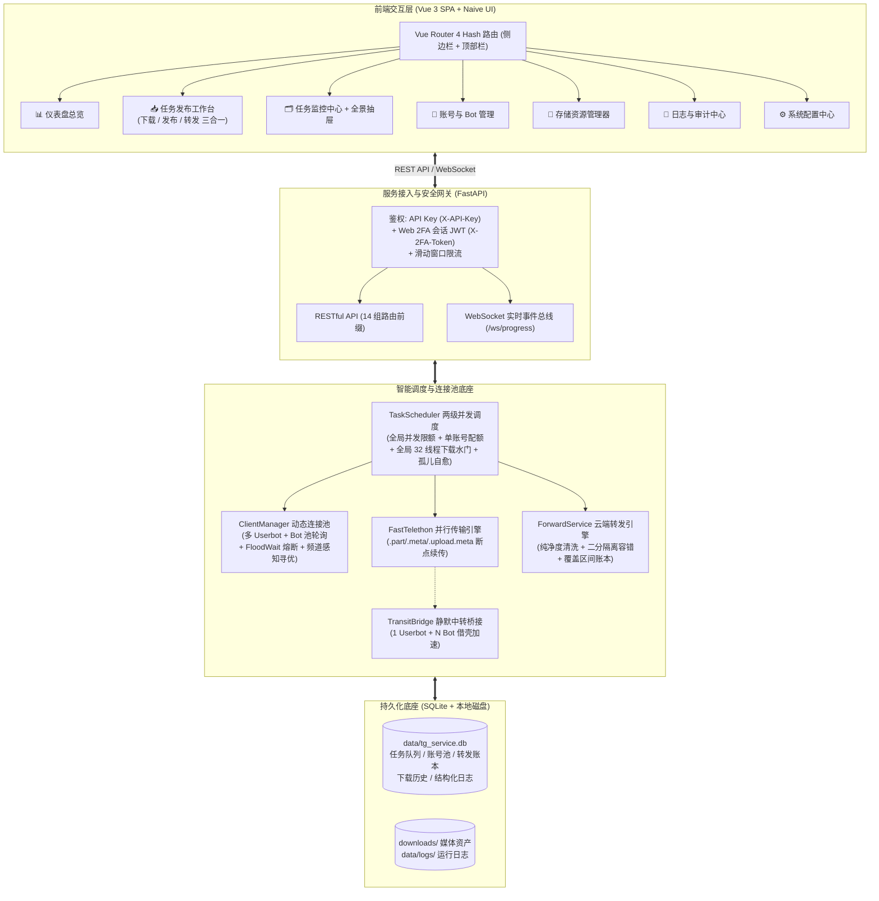

# 🚀 tg-media-hub (Telegram Media Automation Suite)

[](LICENSE)
[](https://www.python.org/)
[](https://fastapi.tiangolo.com/)
[](https://vuejs.org/)
[](https://www.docker.com/)


> ⚠️ **免责声明与合规提示（务必先读）**
>
> 1. 本项目仅供个人合规学习、自动化运维与个人数据备份使用，**严禁用于盗版分发、侵权媒体传播或其他非法用途**。下载/转发受版权保护的内容前，请确认你拥有相应权利。
> 2. 使用本项目即表示你已阅读并同意遵守 Telegram 官方 [Terms of Service](https://telegram.org/tos)。高频请求可能触发 Telegram API 限流（FloodWait），**因滥用导致账号限速或封禁的风险由使用者自行承担**，作者不承担任何责任。
> 3. 「受限内容下载」「中转借壳加速」等能力属于 Telegram 客户端协议既定行为的技术封装，是否可用取决于源频道设置与你的账号权限；请勿用于绕过付费墙或窃取他人私有内容。
> 4. 请妥善保管 `.env`、`.session` 文件与 API Key。它们等同于你的 Telegram 账号凭据，泄露即等于账号失窃。

> 📖 **官方技术文档中心**：已全面上线，涵盖分层架构、全量 RESTful API 规范（14 组业务模块）、全量环境变量参考及流媒体切片深度设计，详见 [**docs/README.md**](docs/README.md)

基于 **FastAPI + Telethon + FastTelethon 多通道并行传输 + SQLite DB-First + WebSocket** 构建的 Telegram 媒体辅助中心：受限内容下载、本地媒体发布、**PikPak 云端零落地流式搬运**、**超限大文件流式可播切片与音画对齐**、**媒体占位卡与原地编辑自愈**、云端转发搬运、多账号调度与存储治理一体化。

**English summary**: tg-media-hub is a self-hosted Telegram media workbench. A FastAPI backend (Telethon + FastTelethon, 16 parallel chunk connections by default) drives multi-account scheduling (a pool of bot tokens plus multiple userbot sessions), restricted-content downloads with chunk-level resumable transfer (`.part/.meta/.upload.meta`), zero-disk PikPak cloud streaming relay, playable stream splitting with AV sync, placeholder cards with in-place edit healing, cloud-side message forwarding with bisect-based fault isolation and a coverage ledger, local folder publishing with a 4-bot round-robin / userbot split, a storage quota engine, an audit ledger, and a Vue 3 + Pinia + Naive UI SPA (light-card visual system, Web 2FA + API-Key auth, WebSocket live progress). Deployable via a 3-stage Dockerfile + docker-compose. For personal, ToS-compliant use only.

---

## 🏛️ 系统架构全景 (System Architecture)



---

## ✨ 核心特性 (全部对应真实代码实现)

### 多账号体系：Bot 池 + 多 Userbot
- **Bot 令牌池轮询**：`TG_BOT_TOKENS` 逗号分隔录入多个 Bot（推荐 4 个），按就绪健康度轮询分发（`app/core/client_manager.py`），支持 Web 控制台热插拔增删与毫秒级延迟探活（`/api/bots/ping`，`app/api/accounts.py`）。
- **多 Userbot 全生命周期管理**：Web 动态录入账号（手机号 + 验证码 + 可选 2FA 密码）、独立 API 凭据、单账号最大并发数（`app/api/accounts.py`）；**主备分级**（primary/secondary）下下载任务优先借调辅助账号（`app/core/client_manager.py`）。
- **拟人化设备指纹**：每个账号自动分配稳定的设备档案（机型/系统/客户端版本，`app/core/client_manager.py`）。
- **FloodWait 精准熔断**：420 限流即时将账号/Bot 置入冷却隔离并倒计时自动解封（`app/core/client_manager.py`），调度器按退避策略重试（`app/core/scheduler.py`）。

### 频道感知动态账号调度与故障转移
- **私有频道感知寻优**：提交任务时对候选账号并发执行 3 秒轻量探针，优先指派已具备目标频道访问权限的账号（`app/core/client_manager.py`），结果带防雪崩缓存（TTL 默认 60 秒，`USERBOT_ACCESS_CACHE_TTL`，`app/core/client_manager.py`）。
- **发布任务写权限探测**：发布前探测各账号对目标频道的管理员发帖权限（`app/core/client_manager.py`）。
- **运行中故障转移**：转发/下载途中遇权限异常时，自动寻找替代账号接替并同步任务归属与前端 Worker 展示（`app/services/forward_service.py`、`app/core/client_manager.py`）。
- **会话失效统一处置**：Session 被吊销/失效时任务统一置失败并广播事件引导重绑（`app/core/session_errors.py`）。

### 任务预检
- **频道访问预检**：`POST /api/tasks/precheck-access` 在提交前探测指定账号或全账号池对目标频道的可达性、受限状态并给出明确失败原因（`app/api/tasks.py`）。
- **范围下载预检**：`POST /api/download/inspect-range` 统计区间媒体总数/类型分布/预估体积、本地防重命中数，检测磁盘剩余空间（含 5% 安全余量）并预测中转加速资格（`app/services/downloader_service.py`）。
- **发布预检**：`POST /api/publish/inspect` 扫描本地目录、探测账号 Premium 身份与动态上传上限、附带目标频道发帖权限诊断（`app/api/publish.py`）。

### 受限内容下载
- 支持 `t.me/c/…` 私有频道、公开频道消息链接与频道区间批量下载；对开启 noforwards（受限内容保护）的频道自动启用保存模式并在预检中明确标注（`app/services/downloader_service.py`）。
- **Album 相册聚合**：按 `grouped_id` 自动抓取同组媒体（±10 条窗口、5 秒超时保护）作为单一逻辑单元下载（`app/services/downloader_service.py`）。
- **数据库级防重**：按「源频道 ID + 消息 ID」去重，重复提交自动跳过（`app/services/downloader_service.py`）；成品落库前流式计算 SHA-256（1MB 分块，`app/core/hash_utils.py`、`app/services/downloader_service.py`）。

### FastTelethon 分块断点续传
- **16 通道并发**：默认 16 条独立 MTProto Sender 通道分块拉取（`PARALLEL_CONNECTIONS`，`app/config.py`；下载引擎 `app/core/fast_telethon/` 子包），支持多 Client（主 Userbot + Bot 池）各持专属凭证联合下载，无权访问的 Client 被自动剔除（`app/services/downloader_service.py`）。
- **下载断点 `.part/.meta`**：分块完成位图持久化到 `.meta`，中断后仅补齐缺失分块；分块覆盖率不足时抛出 `DownloadIncompleteError` 拒绝伪装成功（`app/core/fast_telethon/download_engine.py`）。
- **上传断点 `.upload.meta`**：上传分块断点持久化，内置 2 小时 TTL 过期自愈（服务端临时分块超时后自动丢弃旧断点全量重传）与 `force_fresh` 强制重传（`app/core/fast_telethon/breakpoints.py`）。
- **多 Userbot 联合下载开关**：`ENABLE_MULTI_USERBOT_DOWNLOAD` 控制下载时是否组装多客户端联合通道（`app/api/download.py`）。

### 云端转发引擎（二分隔离容错）
- **0 硬盘开销**：消息由 Telegram DC 云端直转目标频道，宿主机不落盘、不耗带宽（`app/services/forward_service.py`）。
- **前置纯净度清洗**：本地 0 RPC 过滤空消息、系统动作消息、幽灵消息与全平台 TOS 死亡消息，过滤记录逐条留痕（`app/services/forward_service.py`）。
- **二分隔离容错**：批次转发遇不可恢复坏消息（如已删除的 MESSAGE_ID_INVALID）时按 O(log N) 二分递归隔离，单条定位后安全跳过；FloodWait 触发顶级熔断休眠（可中断、可视化倒计时）；WorkerBusy 瞬态指数退避（`app/services/forward_service.py`）。
- **覆盖区间账本**：成功映射、过滤处置与覆盖区间单事务落库；重复执行按批剔除已处理消息（0 重复），断点续转从首个未覆盖 Gap 起点，无需重转（`app/services/forward_service.py`、`app/core/intervals.py`）。
- **Album-Aware 分批**：相册消息按 `grouped_id` 原子对齐，防止相册被批次边界撕裂（`app/services/forward_service.py`）。
- **试转模式**：`dry_run=True` 首批完成后自动暂停，验收后一键恢复全量（`app/services/forward_service.py`）。
- **自适应节流**：按 RPC 结果动态调节发包间隔（0.5s~8s）并叠加拟人化抖动（`app/services/forward_service.py`）。
- **覆盖测算与回执**：`/api/forward/estimate`、`/api/forward/coverage`、`/api/forward/coverage/gaps`、`/api/forward/receipt/{task_id}` 提供区间测算、覆盖可视化与完成回执（`app/api/forward.py`）。

### 静默中转群借壳加速（可选，梯队 1）
- 配置中转群后，满足条件的下载自动先将消息原子转发至中转群，组装「1 Userbot + N 就绪 Bot」联合客户端池并发拉取，结束后 `finally` 强制删除中转群临时消息（零残留）（`app/services/transit_bridge_service.py`）。
- 五重准入门控：功能开关、中转群 ID、非同群防环路、Bot 池就绪、noforwards 检查与体积阈值（`TRANSIT_MIN_FILE_SIZE_MB`，默认 20MB）（`app/services/transit_bridge_service.py`）。
- 中转受限/异常时静默降级直连下载；`/api/settings/verify-transit` 提供中转群健康度探针（Userbot 发信/删信权限 + 各 Bot 在群状态）（`app/services/transit_bridge_service.py`）。

### 本地媒体双模发布
- **目录扫描预检**：`POST /api/publish/inspect` 全量扫描本地目录，按图片/视频/音频归类统计，动态探测所选账号的 Premium 身份与实际上传上限，并附带目标频道发帖权限诊断（`app/api/publish.py`）。
- **双模分流**：发布任务开始时读取阈值快照（设置中心 `userbot_upload_threshold_mb`，默认 30MB，`app/services/publisher_service.py`）：不超过阈值的文件走 Bot 池轮询分摊限流，超过阈值的文件走 Userbot 多通道并行上传（相册与单文件发布逻辑见 `app/services/publisher_service.py`）。
- **图片 Album 打包**：同目录图片最多 10 张打包为单个 Album 发送，视频/音频独立单发并附带文件名 Caption（`app/services/publisher_service.py`）。
- **发布防重**：发布历史带 SHA-256 哈希辅助索引（`app/db/database.py`），已发布到相同目标频道的文件自动跳过；缺失哈希时回退旧「目标频道+路径+体积」三元组键（`app/services/publisher_service.py`）。
- **发布前熔断与总结**：任务开始时对目标频道执行写权限探针，零上传成本快速熔断无权限任务（`app/services/publisher_service.py`）；每个文件夹发布完成后向频道推送成功/失败总结消息。

### 存储配额引擎与守卫式治理
- **双约束配额**：有效可用容量 = min(物理磁盘剩余， 配额剩余)；配额上限经设置中心 `max_storage_quota_gb` 热配置（0 为不设限）（`app/services/storage_service.py`）。
- **存储登记表**：启动时全量扫描 `downloads/` 登记 `storage_registry`，区分成品/断点碎片并关联归属频道与任务（`app/services/storage_service.py`）。
- **孤儿断点识别与清理**：`.part/.meta` 配对检测，无活跃任务关联的孤儿碎片一键清理；存在进行中下载任务时断点锁定拒绝清理（`app/services/storage_service.py`）。
- **三重守卫删除**：路径边界（仅限 `downloads/` 沙箱内，严禁 `..` 穿越，`app/services/storage_service.py`）+ 活跃路径内存登记 + 运行态任务交叉校验（`app/services/storage_service.py`）；成品删除联动清理下载历史，但绝不触碰发布防重历史。
- **HTTP 206 流式播放**：内置基于 Range 分块的媒体点播（256KB 流式读取），支持超大视频拖拽快进（`app/api/storage.py`）。

### 任务中心全景抽屉
- 任务矩阵支持按状态（pending/queued/running/paused/completed/failed/cancelled）、类型（download_link/download_range/forward_channel/publish_folder/publish_pikpak）、账号与关键词筛选，服务端分页并返回全库级 `status_counts` 统计（`app/api/tasks.py`）。
- 单任务/批量暂停、恢复、重试、取消、删除与清空已完成；整队暂停/恢复（`/api/tasks/queue/pause|resume`）（`app/api/tasks.py`）。
- 全景抽屉：实时速度 SVG 折线（25 点滚动窗口）、ETA、DC 线程分布、执行 Worker、重试计数、断点文件反查（.part/.meta）、任务级流式日志终端（级别过滤 + 关键字搜索 + 一键导出）与转发覆盖账本视图（`frontend/src/components/tasks/TaskDetailDrawer.vue`）。
- 调度器全景：全局并发上限（默认 3，1~20 可热调）、单账号配额、全局 32 线程下载水门（`MAX_GLOBAL_DOWNLOAD_THREADS = 32`）、游标滚动扫描（批次 50/预算 500）与错峰启动抖动（`app/core/scheduler.py`）。

### 审计与日志
- **转发清洗/坏消息隔离审计账本**：`GET /api/audit/forward-skips` 分页查询每条被过滤/隔离消息的类型与原因（`app/api/audit.py`）。
- **发布与下载失败结构化审计**：`publish_failures.jsonl` 与下载失败审计（`GET /api/audit/publish-failures`、`GET /api/audit/download-failures`）按 FLOOD_WAIT / NETWORK_TIMEOUT / FILE_TOO_LARGE 等分类查询（`app/api/audit.py`、`app/core/failure_logger.py`）。
- **任务日志与系统日志**：任务级结构化日志流（seq 增量拉取 + 启动期按 `TASK_LOGS_RETENTION_PER_TASK` 自动修剪）与全局系统日志检索（`app/api/logs.py`）。
- 注意：当前版本**未提供**「账号变更/凭证录入」操作审计，请勿按此类能力评估。

### 预设系统
- 频道预设（target/source 双类型）保存、一键应用与频道探针校验（`app/api/presets.py`），下载/发布/转发/PikPak 四大工作台均已接入（`frontend/src/views/create/`、`frontend/src/components/presets/PresetManageModal.vue`）。

### Web 2FA + API Key 鉴权与短时效票据
- **默认账号准入**：默认 Userbot 缺少可验证会话时，服务先开放受限绑定页。部署者凭 `TG_BOOTSTRAP_TOKEN` 完成 Telegram 身份验证后，控制台、媒体和任务才可用。
- **API Key 门禁**：配置 `API_KEY` 后全站业务路由强制 `X-API-Key` 请求头（严禁 URL 明文传参防日志泄露，`app/api/auth.py`）。
- **Web 2FA 动态验证码**：登录时向 Userbot「收藏夹」发送 6 位验证码（3 分钟有效、错 3 次锁 IP 30 分钟）（`app/core/client_manager.py`）；验证通过签发 24 小时 HS256 JWT 会话（`app/api/auth.py`）。
- **会话签名密钥**：未设置 `SECRET_KEY` 时，服务生成并持久保存独立的签名密钥（`app/api/auth.py`）。
- **短时效媒体与 WebSocket 票据**：前端通过双 Header 调用 `POST /api/auth/media-ticket` 签发 60 秒 TTL 随机票据，供浏览器原生 `<video>` 流式播放（`/api/storage/preview`、`/api/storage/download`）与 WebSocket 握手（`/ws/progress?ticket=<ticket>`）鉴权，彻底消除 URL 明文传递 `token=` / `api_key=`（鉴权失败统一以 `1008 Policy Violation` 拒绝，`app/api/auth.py`）。
- **滑动窗口限流**：单 IP 每分钟请求数限流（默认 120，`RATE_LIMIT_PER_MINUTE<=0` 关闭；进程内存实现，多副本部署需自行前置网关限流）（`app/api/auth.py`、`app/main.py`）。
- **本机免认证与公网锁定**：本机回环直连可留空 `API_KEY`。公网反代必须设置 `CONSOLE_REQUIRE_API_KEY=true`，官方 Compose 已启用。公网入口缺少 Key 时，业务 API、媒体和 WebSocket 锁定，受保护的首次绑定、最小公开状态和健康检查仍可用。

### 浅色卡片视觉系统
- 默认**浅色卡片**主题（微灰微蓝画布、大圆角 16px、柔和弥散阴影，对齐 Cockpit Tools 规范），支持浅色/深色/跟随系统三模式切换与「减少动效」无障碍选项（`frontend/src/stores/themeStore.ts`、`frontend/src/styles/main.css`）。

---

## 🔄 启动自愈与基线持久化治理

- **自动凭据导入**：首次启动时若账号/Bot 表为空，自动将 `.env` 中的 `TG_API_ID/TG_API_HASH/TG_DEFAULT_PHONE/USERBOT_SESSION_NAME` 注册为默认主账号，`TG_BOT_TOKENS` 逐个注册入库；既有 `.session` 文件直接兼容（`app/db/database.py`）。
- **Baseline-Only 数据库与日志修剪**：采用 `_create_baseline_tables` 作为唯一 Schema 真源（`PRAGMA user_version = 1`），每次启动自动按 `TASK_LOGS_RETENTION_PER_TASK`（默认 5,000 条/任务）修剪历史任务日志，防止 SQLite 库体积无界膨胀（`app/db/database.py`、`app/db/task_repository.py`）。
- **开机安全自愈**：重启后遗留的 running/pending/queued 任务默认统一转置为 `paused`（断点与账本进度完整保留）；将 `AUTO_RESUME_TASKS_ON_STARTUP=true`（或设置中心同名动态项）则自动转 `queued` 恢复调度（`app/core/scheduler.py`、`app/config.py`）。

---

## ⚡ 快速开始 (Quickstart)

### 方式一：Docker Compose 部署（推荐）

```bash
git clone https://github.com/anonham/TG-Media-Hub tg-media-hub
cd tg-media-hub
cp .env.example .env # 填写 Telegram 凭证（见下方环境变量表）
docker compose up -d --build
```

浏览器打开 `http://localhost:8500`。`API_KEY` 留空时仍可用部署者引导密钥完成首次绑定。要使用控制台业务，请在 `.env` 配置强随机 `API_KEY`，执行 `docker compose up -d` 重新注入配置。

- 镜像为 3 阶段 Multi-Stage 构建：Node 24 Alpine 编译前端 → python:3.12-slim 编译 C 扩展 → 最终镜像剥离全部编译链与 Node（`Dockerfile`）。最终体积基于 python:3.12-slim，具体大小以 `docker images` 实测为准。
- 默认端口映射绑定宿主回环 `127.0.0.1:8500:8500`，不对局域网裸露；如需外部访问请自行修改 `docker-compose.yml` 的 `ports` 左侧并评估暴露风险（`docker-compose.yml`）。
- **容器内端口固定为 8500**（`EXPOSE 8500` 与容器健康检查均硬编码，`Dockerfile`、`docker-compose.yml`），Docker 场景请保持 `PORT=8500`；更换对外端口只调整 `ports` 左侧。
- 持久化卷：`tg-media-hub_data` → `/app/data`（SQLite + `.session` 会话文件 + `.pikpak` 凭据 + 上传断点元数据 + 日志），`tg-media-hub_downloads` → `/app/downloads`（`docker-compose.yml`）。
- 新建 `.session` 会话文件默认统一收拢落盘于 `data/` 沙箱目录（容器内随 `tg-media-hub_data` 持久卷保存）；跨机迁移与备份规范详见 [DEPLOYMENT.md](docs/guides/DEPLOYMENT.md) 与 [TROUBLESHOOTING.md](docs/guides/TROUBLESHOOTING.md)。
- 容器以非特权用户 `appuser`（UID/GID 10001）运行并启用 `no-new-privileges`（`Dockerfile`、`docker-compose.yml`）。

### 方式二：本地开发部署

```bash
# 1. 前端构建（产物输出至 ../static，vite.config.js）
cd frontend
pnpm install
pnpm run build
cd ..

# 2. 后端（Python 3.12+，采用 uv 进行环境与依赖管理）
uv sync
uv run python run.py
```

- `run.py` 启动时自动顺延探测可用端口（最多 +20）并打印实际地址（支持 `--host`、`--port`、`-V/--version` CLI 参数，`run.py`）；默认监听 `127.0.0.1:8500`。
- 前端 HMR 热开发：`cd frontend && pnpm run dev`（`http://127.0.0.1:5173`，已内置 `/api` 与 `/ws` 向 8500 的反向代理，`frontend/vite.config.js`）。
- 运行测试：`uv run pytest -q`（98 个测试文件、2,600+ 条测试，pytest 配置位于 `pyproject.toml`，默认开启 `asyncio_mode = "auto"`）。

---

## 📖 API 接口索引

Swagger UI `http://localhost:8500/docs` 与 ReDoc `http://localhost:8500/redoc` 仅在本机直连模式开放。公网部署可凭 `X-API-Key` 程序化拉取 `/openapi.json`。通过前置门禁后，匿名公网文档请求返回 `404`。

除标注外，以下路由在配置 `API_KEY` 后均要求 `X-API-Key` + `X-2FA-Token` 双凭据（挂载关系见 `app/api/__init__.py`）：

| 路由前缀 | 模块职责 | 核心端点 |
| :--- | :--- | :--- |
| `/api/auth` | 鉴权状态、Key 校验与短时效媒体票据（status 公开） | `GET /status`、`GET /verify`、`POST /media-ticket` |
| `/api/telegram` | Web 2FA 验证码与原生登录 | `POST /web-2fa/send`、`POST /web-2fa/verify`、`POST /native/send-code`、`POST /native/verify-code` |
| `/api/accounts` | Userbot 账号池增删改查/验证码登录/状态刷新 | `GET ""`、`POST ""`、`POST /{id}/send-code`、`POST /{id}/verify-code`、`PUT /{id}`、`DELETE /{id}` |
| `/api/bots` | Bot 令牌池管理与探活 | `GET ""`、`POST ""`、`POST /ping`、`DELETE /{id}` |
| `/api/download` | 受限内容下载 | `POST /inspect-range`、`POST /link`、`POST /range` |
| `/api/publish` | 本地媒体发布 | `POST /inspect`、`POST /folder` |
| `/api/pikpak` | PikPak 云端鉴权、目录浏览与流式发布 | `GET /auth/status`、`POST /auth/device/start`、`POST /auth/device/poll`、`GET /files/list`、`POST /inspect`、`POST /publish` |
| `/api/forward` | 云端转发引擎 | `POST /inspect`、`POST /channel`、`GET /history`、`POST /estimate`、`GET /receipt/{task_id}`、`GET /coverage`、`GET /coverage/gaps` |
| `/api/presets` | 频道预设管理 | `GET ""`、`POST /inspect`、`POST ""`、`DELETE /{id}` |
| `/api/tasks` | 任务队列、并发热调与预检 | `POST /precheck-access`、`GET ""`、`GET /{id}`、`GET /{id}/logs`、`PATCH /{id}/concurrency`、`POST /queue/pause`、`POST /queue/resume`、`POST /{id}/pause\|resume\|retry\|cancel`、`DELETE /{id}`、`POST /batch`、`DELETE ""` |
| `/api/storage` | 存储治理与媒体流播放 | `GET /overview`、`POST /scan`、`GET /files`、`GET /preview/{path}` (206)、`GET /download/{path}`、`GET /breakpoints`、`POST /clean-orphans`、`GET /metrics`、`POST /quota`、`PUT /quota`、`DELETE /files`、`POST /delete` |
| `/api/logs` | 任务日志与系统日志 | `GET /tasks/{task_id}`、`GET /system` |
| `/api/audit` | 转发清洗账本与发布/下载失败审计 | `GET /forward-skips`、`GET /publish-failures`、`GET /download-failures` |
| `/api/settings` | 动态配置中心 | `GET ""`、`PUT ""`、`POST /verify-transit` |
| `/metrics` | Prometheus 运行时监控指标（内存态导出；配置 `API_KEY` 后须携带 `X-API-Key`，无需 2FA） | `GET /metrics` |
| `/ws/progress` | WebSocket 实时进度/日志/任务事件总线 | — |

> 注：`/api/storage` 的媒体预览/下载端点与 `/ws/progress` WebSocket 握手均采用 `POST /api/auth/media-ticket` 签发的 60s TTL 短时效票据（`?ticket=<ticket>`）鉴权，禁止在 URL 查询参数中明文传递 API Key 或 JWT（`app/api/auth.py`）。

---

## ⚙️ 环境变量配置说明（与 `app/config.py` 逐项对齐）

> 💡 **完整环境变量手册**：包含全部 30+ 环境变量详细参数、默认值、影响模块与已知配置差异避坑，请查阅 [**docs/guides/CONFIGURATION.md**](docs/guides/CONFIGURATION.md)。

所有变量均可在 `.env`（项目根目录，`app/config.py` 的极简加载器，已存在的环境变量优先）或系统环境变量中设置。

### Telegram 凭证

| 变量名 | 必填 | 默认值 | 说明 |
| :--- | :---: | :--- | :--- |
| `TG_API_ID` | ✅ | — | Telegram API ID（[my.telegram.org](https://my.telegram.org) 申请；缺失时启动报错，`app/config.py`） |
| `TG_API_HASH` | ✅ | — | Telegram API Hash（32 位十六进制） |
| `TG_BOT_TOKENS` | ✅ | — | Bot 令牌池，逗号分隔（推荐 4 个；`app/config.py`） |
| `TG_DEFAULT_PHONE` | ❌ | 空 | 首绑时锁定的国际格式手机号。留空时由已认证部署者指定 |
| `USERBOT_SESSION_NAME` | ❌ | `userbot_session` | 默认主账号 Session 文件名前缀 |

### Web 服务

| 变量名 | 必填 | 默认值 | 说明 |
| :--- | :---: | :--- | :--- |
| `HOST` | ❌ | `127.0.0.1` | 本机监听地址，官方 Compose 在容器内显式设为 `0.0.0.0` |
| `PORT`（或 `TG_PORT`） | ❌ | `8500` | Web 端口。本地启动被占用时自动顺延（最多 +20）；**Docker 场景保持 8500**（容器健康检查硬编码，见上文） |
| `TG_BOOTSTRAP_TOKEN` | 首绑或恢复 | 空 | 部署者引导密钥，使用独立的高熵随机值，仅在默认账号待验证时使用 |
| `API_KEY` | ❌ | 空 | 控制台访问口令。仅绑定 `127.0.0.1`/`::1` 的本机直跑且留空时免认证；容器/公网/反代入口必须配置强随机值，否则控制台整体锁定并提示配置（历史别名 `TG_API_KEY` 已移除，残留且未设 `API_KEY` 时启动直接报错要求改名） |
| `CONSOLE_REQUIRE_API_KEY` | 公网反代 | `false` | 设为 `true` 对整个实例禁用本机豁免。官方 Compose 已启用 |
| `SECRET_KEY` | ❌ | 空 | Web 2FA 会话签名密钥。留空时使用数据目录中独立生成的密钥 |
| `TRUSTED_PROXIES` | ❌ | `172.16.0.0/12,127.0.0.1` | 可信反代网段白名单（CIDR），透传 uvicorn `forwarded_allow_ips` 以还原真实客户端 IP；**禁止设为 `*`**（启动时直接拒绝，`run.py`） |
| `CORS_ORIGINS` | ❌ | `http://localhost:8500,http://127.0.0.1:8500` | CORS 允许来源，逗号分隔（`app/config.py`） |
| `RATE_LIMIT_PER_MINUTE` | ❌ | `120` | 单 IP 滑动窗口限流阈值（次/分钟）；`<=0` 关闭 |

### 下载 / 发布引擎

| 变量名 | 必填 | 默认值 | 说明 |
| :--- | :---: | :--- | :--- |
| `MAX_FILE_SIZE_MB` | ❌ | `2000` | 非 Premium 账号单文件上传上限（MB） |
| `PREMIUM_MAX_FILE_SIZE_MB` | ❌ | `4000` | Premium 账号单文件上传上限（MB）；协议绝对硬顶 4096 MiB (4.00 GiB) 不可逾越（`app/config.py`） |
| `USERBOT_UPLOAD_THRESHOLD` | ❌ | `30` | 发布分流阈值，**按 MB 解析**：超过阈值的文件自动切 Userbot 上传，否则走 Bot 轮询。设置中心动态项 `userbot_upload_threshold_mb` 优先生效，本变量仅在该动态项缺失时兜底（`app/config.py`） |
| `DEFAULT_TARGET_CHANNEL` | ❌ | `-1009000000010` | 默认转存目标频道 ID（占位值，请改为自己的频道） |
| `AUTO_RESUME_TASKS_ON_STARTUP` | ❌ | `false` | 启动时自动恢复遗留任务为 queued（默认 false = 安全暂停保护）；设置中心同名动态项可覆盖环境变量（`app/core/scheduler.py`） |

### 多 Userbot 与中转加速

| 变量名 | 必填 | 默认值 | 说明 |
| :--- | :---: | :--- | :--- |
| `ENABLE_MULTI_USERBOT_DOWNLOAD` | ❌ | `true` | 下载时是否组装多客户端（主 Userbot + Bot 池）联合并发通道（`app/api/download.py`） |
| `USERBOT_ACCESS_CACHE_TTL` | ❌ | `60.0` | 私有频道账号可达性探针缓存 TTL（秒），防止重复探测引发 API 压力（`app/core/client_manager.py`） |
| `ENABLE_TRANSIT_ACCELERATION` | ❌ | `true` | 静默中转群借壳加速总开关（设置中心动态项可覆盖） |
| `TRANSIT_CHAT_ID` | ❌ | 空 | 中转群组/频道 ID（如 `-100xxxxxxxxxx`）；留空则中转加速不生效 |
| `TRANSIT_MIN_FILE_SIZE_MB` | ❌ | `20` | 触发中转加速的最小文件体积（MB） |

> 另有仅用于 pytest 的 `TEST_CHANNEL_LINK` / `TEST_SAMPLE_FOLDER`（见 `.env.example`），运行时不参与业务逻辑。

### ⚠️ 已知配置差异（如实说明）

1. **`USERBOT_UPLOAD_THRESHOLD` 单位**：设置中心动态项 `userbot_upload_threshold_mb`（MB）是发布分流的**唯一事实源**，发布任务开始时实时读取（`app/services/publisher_service.py`），修改后对下一个任务生效、无需重启；环境变量 `USERBOT_UPLOAD_THRESHOLD` 按 **MB** 解析（默认 30，`app/config.py`），仅在该动态项缺失时兜底——正常部署中种子行已存在，调整阈值请使用设置中心。
2. **设置中心动态项**（SQLite `system_settings` 表，热生效，种子值见 `app/db/database.py`）：`max_global_concurrency`（默认 3，1~20）、`default_target_channel`、`userbot_upload_threshold_mb`（30，发布分流唯一事实源，见上）、`max_storage_quota_gb`（0 = 不限）、`enable_transit_acceleration`、`transit_chat_id`、`transit_min_file_size_mb`（20）。`auto_resume_tasks_on_startup` 亦可作为动态项读取（环境变量作默认值）。

---

## 🗂️ 目录结构（真实文件树）

```text
tg-media-hub/
├── app/ # FastAPI 后端（严格单向分层：api → services → core → db）
│ ├── api/ # 路由层（14 组业务前缀 + Prometheus + WebSocket）
│ │ ├── __init__.py # 路由聚合与双层鉴权挂载
│ │ ├── accounts.py # Userbot/Bot 账号池管理
│ │ ├── audit.py # 转发清洗账本 / 发布与下载失败审计
│ │ ├── auth.py # API Key + 2FA JWT + 短时效媒体票据 + 限流中间件
│ │ ├── download.py # 下载预检与任务创建端点
│ │ ├── forward.py # 转发预检、任务创建与覆盖账本端点
│ │ ├── logs.py # 任务/系统日志查询
│ │ ├── metrics.py # Prometheus 监控指标导出 (/metrics)
│ │ ├── pikpak.py # PikPak 设备码鉴权、目录浏览与流式发布端点
│ │ ├── presets.py # 频道预设管理
│ │ ├── publish.py # 本地发布预检与任务创建（含路径安全沙箱）
│ │ ├── settings.py # 动态配置中心与中转群校验
│ │ ├── storage.py # 存储治理与 206 流式播放
│ │ ├── tasks.py # 任务队列/预检/批量控制/动态并发调谐
│ │ ├── telegram_auth.py # Web 2FA 与原生验证码登录
│ │ └── websockets.py # /ws/progress 实时事件总线
│ ├── assets/ # 随应用分发的静态资产（placeholder_poster.jpg 等）
│ ├── core/ # 核心传输、切片与流水线底座（零向上依赖）
│ │ ├── iso_bmff/ # 纯 Python ISO-BMFF 盒解析与 moov/ftyp 合成引擎 (VSSE v2)
│ │ ├── pikpak/ # PikPak 归档策略、文件树构建与限速器
│ │ ├── pipeline/ # 统一发布流水线 (PublishPipeline / Source / Engine / Cleanup / Placeholder)
│ │ ├── cdn_transport.py # 控制面统一 HTTP 传输层与专享代理热重载
│ │ ├── client_manager.py # 动态连接池 / 账号状态机 / FloodWait 熔断
│ │ ├── connection_manager.py # WebSocket 连接广播管理
│ │ ├── e2e_capture.py # 超限流式切片 E2E 取证捕获会话
│ │ ├── e2e_compare.py # 离线取证对比引擎（A1-A5 断言）
│ │ ├── executor_progress.py # 传输进度节流广播与心跳写库
│ │ ├── failure_logger.py # 结构化失败审计落盘
│ │ ├── fast_telethon/ # 多通道并行下载/上传 + 断点续传 (.part/.meta/.upload.meta)
│ │ ├── fmp4_pipe_uploader.py # 零落盘 FFmpeg fMP4 流式切片与全局 sidx 回填上传器
│ │ ├── hash_utils.py # 流式 SHA-256 计算
│ │ ├── intervals.py # 区间合并/Gap 计算（转发覆盖账本）
│ │ ├── keyframe_prober.py # MKV Cues / MP4 stss 远端与本地关键帧探测
│ │ ├── runtime.py # 全局运行时控制表与优雅停机钩子
│ │ ├── scheduler.py # 两级并发调度器 / 全局 32 线程下载水门 / 孤儿自愈
│ │ ├── session_errors.py # 会话失效识别与统一处置
│ │ ├── stream_chunk_provider.py # HTTP Range 流式分块供给器与 L1 环形缓存
│ │ ├── stream_splitter.py # 虚拟流式分卷规划与阈值推导
│ │ ├── task_strategy.py # TaskTypeStrategy 抽象接口与 StrategyRegistry
│ │ └── vsse_provider.py # VSSE v2 虚拟分卷字节流供给器
│ ├── db/ # SQLite 持久层（WAL + 单写池 + Baseline-Only Schema）
│ │ ├── account_repository.py # 账号/Bot/系统设置仓储
│ │ ├── database.py # 基线建表 (_create_baseline_tables) / 连接缓存与事务封装
│ │ ├── download_repository.py# 下载历史/断点归属仓储
│ │ ├── forward_repository.py # 转发账本仓储（history/skips/coverage）
│ │ ├── preset_repository.py # 频道预设仓储
│ │ ├── publish_repository.py # 发布防重/占位槽 (placeholder_slots) 仓储
│ │ ├── storage_repository.py # 存储登记表 (storage_registry) 仓储
│ │ ├── task_repository.py # 任务队列仓储（status_counts/日志水位/手动级联清理）
│ │ └── write_pool.py # 专用单写者 DB 异步写线程池
│ ├── models/ # Pydantic 强类型领域模型 (auth/task/publish/forward/pikpak/storage/logs/settings)
│ ├── services/ # 业务编排服务与任务策略实现
│ │ ├── task_strategies/ # 五大任务类型策略实现 (DownloadLink/Range, Forward, PublishFolder/PikPak)
│ │ ├── channel_inspector.py # 频道探针（读/写权限诊断）
│ │ ├── downloader_service.py # 下载编排（防重/相册/预检）
│ │ ├── executor_registry.py # 策略与调度器执行器统一装配入口
│ │ ├── forward_service.py # 云端转发（纯净过滤/二分隔离/覆盖账本）
│ │ ├── pikpak_publisher_service.py # PikPak 流式发布服务编排
│ │ ├── pikpak_service.py # PikPak CLI 进程治理、熔断与状态机
│ │ ├── publish_runner.py # 本地与 PikPak 发布执行器入口
│ │ ├── publisher_service.py # 本地目录发布服务编排
│ │ ├── storage_service.py # 存储配额/扫描/守卫式删除
│ │ └── transit_bridge_service.py # 静默中转群借壳加速
│ ├── config.py # 全局配置与环境变量解析
│ └── main.py # FastAPI 应用入口与生命周期治理
├── frontend/ # Vue 3 + TypeScript + Pinia + Naive UI SPA (Node 24+, pnpm 11+)
│ ├── src/
│ │ ├── api/ # @hey-api/openapi-ts 强类型生成 SDK (gen/) + 统一拦截器 client.ts
│ │ ├── components/
│ │ │ ├── auth/ # AuthModal / TelegramAuthModal
│ │ │ ├── console/ # TaskLogTerminal（统一流式日志终端）
│ │ │ ├── forward/ # CoverageBar（转发覆盖可视化）
│ │ │ ├── layout/ # AppLayout / HeaderBar / Sidebar
│ │ │ ├── pikpak/ # PikPakAuthCard / PikPakFileBrowser / PikPakSpeedDashboard
│ │ │ ├── presets/ # PresetManageModal
│ │ │ ├── publish/ # PublishConfigSharedSection
│ │ │ ├── settings/ # Settings 分类配置子面板与元数据 (settingsMetadata.ts)
│ │ │ └── tasks/ # TaskDetailDrawer 及三子面板 (Metrics / Params / Diagnosis)
│ │ ├── router/index.ts # Hash 路由与登录守卫
│ │ ├── stores/ # Pinia ×11（account/auth/forward/log/pikpak/preset/setting/storage/task/telegramAuth/theme）+ taskRealtime.ts
│ │ ├── styles/main.css # 浅色卡片视觉规范 + .cockpit-table + 深色适配
│ │ ├── utils/ # taskNormalizer / taskHelpers / formatters / clipboard / discreteApi / publishConstants
│ │ ├── views/ # Dashboard / TaskCreate / TaskCenter / Accounts / Storage / Logs / Settings / NotFound + create/ 四大创建子视图
│ │ ├── App.vue
│ │ └── main.ts
│ ├── index.html
│ ├── package.json
│ └── vite.config.js # base=/static/，产物输出 ../static
├── scripts/ # 静态规范守卫、E2E 离线取证对比与基准测试脚本
├── docs/ # 官方技术文档中心 (guides / architecture / testing)
│ ├── README.md # 文档全景导航矩阵
│ ├── guides/ # 部署与容器运维、生产排障手册、环境变量字典、API 协议参考
│ ├── architecture/ # 总体架构与术语、发布流水线与占位自愈、流媒体与可播切片、存储治理、前端状态架构
│ └── testing/ # 四层端到端 E2E 验证与用例真源矩阵 (E2E_GUIDE.md)
├── tests/ # pytest 测试体系（98 个测试文件，含单元测试、OpenAPI 快照、e2e_ui 与 e2e_live）
├── .github/workflows/ # CI 流水线（test.yml 全栈硬门禁 + security.yml 六道安全门）
├── .env.example # 环境变量模板（与 app/config.py 双向对齐）
├── docker-compose.yml
├── Dockerfile # 3 阶段 Multi-Stage 构建（内置 FFmpeg 与 pikpak CLI）
├── pyproject.toml # PEP 621 项目元数据、依赖声明与 pytest/ruff/mypy 配置
├── uv.lock # 跨平台精准依赖锁定树
├── run.py # 启动入口（CLI 参数/端口探测/单实例锁/可信代理校验）
└── LICENSE # MIT
```

---

## 🔒 安全工程与部署加固

- **CI 六道安全门**（`.github/workflows/security.yml`）：Gitleaks 密钥扫描、Semgrep SAST（security-audit/secrets/owasp-top-ten/python 规则集）、Bandit Python 专项扫描、pip-audit + pnpm audit 依赖漏洞审计（pnpm 门槛 high）、Hadolint Dockerfile 规范检查。主分支 push/PR 均触发。
- **非特权容器**：`appuser`（UID/GID 10001）运行 + `no-new-privileges:true` + 健康检查用 Python 标准库（无 curl 依赖）（`Dockerfile`、`docker-compose.yml`）。
- **敏感文件 0600 加固**：启动时对 SQLite 数据库与全部 `.session` 文件执行 POSIX 0600（非 Windows 环境）（`app/main.py`、`app/config.py`）。
- **路径沙箱**：存储端点仅允许 `downloads/` 内路径（`app/services/storage_service.py`）；发布源目录拦截 `..` 逃逸、系统敏感目录、凭据目录（`.ssh/.gnupg/.aws/.git` 等）与工程自身根目录（防扫描 `.session/.env`）（`app/api/publish.py`）。
- **SQL 参数绑定**：数据层全部使用占位符参数查询，无字符串拼接 SQL。
- **单实例部署保护**：本服务设计为单进程单实例（`run.py` 内核级文件锁 `data/tg_service.lock`），严防多进程多实例并发导致 SQLite 锁冲突与 Telegram Session 抢占，请勿多开。
- **本机免认证边界与公网锁定**：本机豁免要求回环绑定、数字回环对端、无反代转发标记，且未启用 `CONSOLE_REQUIRE_API_KEY`。绑定 `0.0.0.0` 时，空 Key 连本机回环请求也会锁定。公网反代即使绑定回环也须启用 `CONSOLE_REQUIRE_API_KEY=true`，并设置强随机 `API_KEY`。 [部署与升级方式](docs/guides/DEPLOYMENT.md)
- **Prometheus 监控端点保护**：`/metrics` 为受保护入口 —— 配置 `API_KEY` 后抓取器须携带 `X-API-Key` 请求头（无需 2FA）；本机免认证模式仅放行本机直连；默认 Userbot 未准入期间禁止暴露。在反向代理部署时，仍建议通过 Nginx/Caddy 配置仅允许内网 Prometheus 抓取器所在 IP 访问 `/metrics`，禁止向外部公网直接暴露系统负载与状态指标。
- **镜像体积**：最终镜像基于 `python:3.12-slim` 并剥离编译链（`Dockerfile`）；具体体积请以 `docker images` 实测为准，本文档不作承诺。

---

## 🛠️ 开发与测试

```bash
uv sync # 一键创建/同步 .venv 依赖（包含开发测试套件）
uv run pytest -q # 98 个测试文件（2,600+ 条测试）：调度器/流式切片/转发引擎/断点续传/鉴权/存储/中转桥接等
```

- 速率基准：`scripts/benchmarks/` 提供单客户端、多客户端与真多 TCP 通道的下载速率基准脚本，实测数据请自行运行得出。
- 中转群连通性：`python scripts/verify_transit.py`。

---

## 🤝 社区与贡献

欢迎参与贡献! 提交前请先阅读:

- [CONTRIBUTING.md](CONTRIBUTING.md) — 开发环境、提交前检查清单与 Conventional Commits 规范
- [SECURITY.md](SECURITY.md) — 安全漏洞上报渠道与响应承诺 (请勿以公开 Issue 报告安全问题)
- [CODE_OF_CONDUCT.md](CODE_OF_CONDUCT.md) — 社区行为准则 (Contributor Covenant v2.1 + 项目附加条款)
- [CHANGELOG.md](CHANGELOG.md) — 版本变更记录 (Keep a Changelog 格式)

缺陷报告请使用 Issue 模板; 安全问题或行为准则举报请走私密渠道或联系 [Kabiruham@proton.me](mailto:Kabiruham@proton.me); 功能建议欢迎附带具体场景。

---

## 📄 开源协议

本项目采用 [MIT License](LICENSE) 协议开源。再次提醒：使用本项目产生的任何账号风险与合规责任由使用者自行承担。
