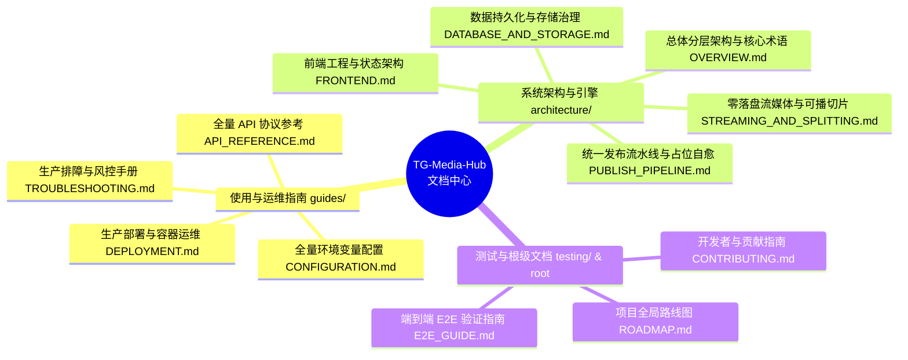

# 📚 TG-Media-Hub 文档中心 (Documentation Hub)

欢迎查阅 **TG-Media-Hub** 官方技术文档库。本文档中心按受众角色扁平化组织为 **使用与运维指南 (`guides/`)**、**系统架构与引擎 (`architecture/`)** 与 **端到端验证 (`testing/`)** 三大正交目录（共 10 篇核心文档），配合根目录的 [贡献指南](../CONTRIBUTING.md) 与 [项目路线图](../ROADMAP.md)，提供零重复、单一事实源（SSoT）的技术参考。

---

## 🧭 文档分类导航全景 (Taxonomy Matrix)

---

## 1. 🎯 使用与运维指南 (`guides/`)
面向系统使用者、运维工程师与外部系统集成开发者：

- 🚀 [**生产部署与容器日常运维指南 (DEPLOYMENT.md)**](guides/DEPLOYMENT.md)
  *涵盖 Docker Compose 容器化编排、裸机部署、Caddy/Nginx HTTPS 反向代理、非 Root 命名卷无损备份还原、代码平滑热更新与四段式优雅停机。*
- 🛠️ [**生产故障排查与风控应对手册 (TROUBLESHOOTING.md)**](guides/TROUBLESHOOTING.md)
  *涵盖 MTProto Session 跨 IP 冲突（`AUTH_KEY_DUPLICATED`）恢复、Telegram `FloodWait` 冷却熔断、私有频道 `access_hash` 全量同步、容器 `UID 10001` 权限修复及低配 VPS 防爆调优。*
- ⚙️ [**系统全量环境变量配置手册 (CONFIGURATION.md)**](guides/CONFIGURATION.md)
  *完整梳理 30+ 项环境变量配置（Telegram 凭据、网络并发、发布门限、PikPak 云端参数、数据库治理等）、默认值与配置优先级避坑。*
- 📡 [**全量 API 与通信协议参考手册 (API_REFERENCE.md)**](guides/API_REFERENCE.md)
  *详细描述全量 70 个 HTTP 操作（覆盖下载、转发、存储、发布等 14 组核心业务模块）、双层 Header + 60s 媒体票据鉴权与 WebSocket 实时事件协议。*

---

## 2. 🏛️ 系统架构与引擎 (`architecture/`)
面向系统架构师与前后端开发者，深入阐述核心子系统的分层设计与流媒体技术护城河：

- 🏛️ [**系统总体分层架构与核心术语 (OVERVIEW.md)**](architecture/OVERVIEW.md)
  *系统六层架构全景图、四层单向依赖红线（AST 静态守卫）、`ClientManager` 连接池、`TaskScheduler` 七态调度器、`FastTelethon` 协议栈、安全模型与 12 项核心术语速查表。*
- 📦 [**统一发布流水线、全链路时序与占位卡自愈 (PUBLISH_PIPELINE.md)**](architecture/PUBLISH_PIPELINE.md)
  *模板方法与四正交策略体系（`ItemSource` / `MediaTransportEngine` / `CleanupStrategy` / `NotificationStrategy`）、六阶段生命周期、4.5GB 超限视频端到端时序图、`engines/` 内部分层以及 `PlaceholderSlotCoordinator` 16:9 占位海报卡原地编辑自愈机制。*
- 🎬 [**零落地流媒体中继与可播分卷切片引擎 (STREAMING_AND_SPLITTING.md)**](architecture/STREAMING_AND_SPLITTING.md)
  *PikPak 零磁盘内存流式中继（HTTP Range 预取 + L1 环形缓存 + JIT 换链 + 三态鉴权 + `dir_tree` 结构化归档）与双轨可播分卷切片规范（`vsse_with_fallback` 纯 Python 虚拟外包络 + `fmp4_universal` 零落盘管道 + $S=K$ 音画同步对齐）。*
- 💾 [**数据持久化与存储治理架构 (DATABASE_AND_STORAGE.md)**](architecture/DATABASE_AND_STORAGE.md)
  *SQLite WAL 模式、三层写并发治理体系（`db_cursor` / `db_immediate_tx` / `submit_db_write`）、300s 定时 Checkpoint、Baseline-Only Schema 治理（`task_logs` 独立分表与级联解绑）与断点沙箱。*
- 🎨 [**前端工程与 Pinia 状态架构 (FRONTEND.md)**](architecture/FRONTEND.md)
  *Vue 3 + Pinia 11 域状态拓扑、OpenAPI 强类型 SDK 自动生成管线、WebSocket 实时增量同步与短时效媒体票据消费流。*

---

## 3. 🧪 测试、贡献与演进规划 (`testing/` & Root)
面向 QA 工程师、代码贡献者与长期维护者：

- 🧪 [**端到端全链路验证与验收指南 (E2E_GUIDE.md)**](testing/E2E_GUIDE.md)
  *统一的四层 E2E 质量保证体系（R 层 CI 门禁 / A 层 Playwright UI / L 层 Live Harness / H 层人工感官体验）、实机冒烟步骤、73 条全量回归用例真源矩阵与 E2E 捕获取证指引。*
- 💻 [**开发者与贡献者指南 (CONTRIBUTING.md)**](../CONTRIBUTING.md)
  *本地研发环境搭建、测试沙箱零副作用红线、分层依赖与 Python 编码规范、Baseline-Only 数据库规范及 PR 提交前五连门禁清单。*
- 🗺️ [**项目全局路线图 (ROADMAP.md)**](../ROADMAP.md)
  *开源首发版本（v1.0.0）与未来演进规划（v1.1 存储配额硬拦截、多云存储插件化与分布式 Worker）。*

---

## 💡 推荐阅读路线 (Recommended Reading Paths)

- **初次部署与生产运维**：[生产部署指南](guides/DEPLOYMENT.md) $\to$ [环境变量配置手册](guides/CONFIGURATION.md) $\to$ [生产排障与风控手册](guides/TROUBLESHOOTING.md)。
- **深入理解架构与流媒体原理**：[系统总体架构与术语](architecture/OVERVIEW.md) $\to$ [统一发布流水线与占位自愈](architecture/PUBLISH_PIPELINE.md) $\to$ [零落地流媒体与可播切片引擎](architecture/STREAMING_AND_SPLITTING.md)。
- **参与代码贡献与测试验收**：[开发者与贡献指南](../CONTRIBUTING.md) $\to$ [前端状态架构](architecture/FRONTEND.md) / [数据库存储治理](architecture/DATABASE_AND_STORAGE.md) $\to$ [端到端 E2E 验证指南](testing/E2E_GUIDE.md)。
