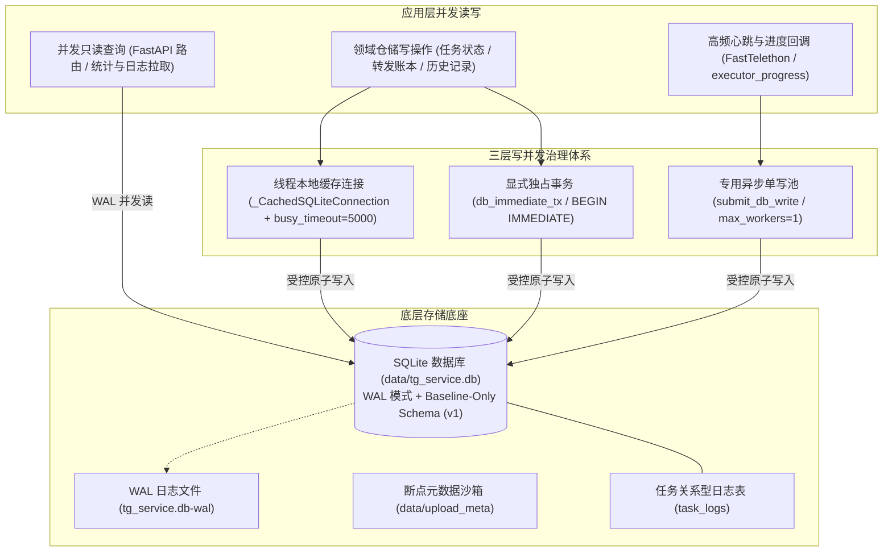

# 💾 数据持久化与存储治理架构 (Database & Storage Architecture)

本文档面向系统架构师与后端开发者，阐述 TG-Media-Hub 的数据持久化体系、高并发读写治理以及 SQLite Baseline-Only 架构设计（`PRAGMA user_version = 1`）。

---

## 1. 持久化存储全景

系统的持久化层由轻量级嵌入式关系数据库（SQLite WAL 模式）与文件系统沙箱共同组成：



---

## 2. 三层写并发治理与 WAL 自保机制

### 2.1 三层写机制与锁竞争根除
SQLite 在默认模式下并发写入容易触发 `sqlite3.OperationalError: database is locked`。系统结合 WAL 模式、线程本地连接缓存（`_CachedSQLiteConnection`，配置 `PRAGMA busy_timeout = 5000` 与 `PRAGMA synchronous = NORMAL`）以及按场景分级的 **三层写机制** 消除锁冲突：
1. **常规单语句仓储写入 (`db_cursor(commit=True)`)**：各领域仓储（`TaskQueueRepository` 的 `*_async` 包装方法、`PublishHistoryRepository`、`AccountRepository` 等）通过 `asyncio.to_thread` 在工作线程中复用线程本地连接执行单语句原子提交；
2. **多语句/跨表独占事务 (`db_immediate_tx()`)**：涉及状态竞态守卫、任务重试重置（`reset_task_for_retry`）、级联清理（`_cascade_task_cleanup`）与转发账本批量落库的操作，显式开启 `BEGIN IMMEDIATE` 事务，在事务伊始即获取写锁，杜绝读锁升级死锁与数据撕裂；
3. **高频非阻塞进度写池 (`submit_db_write()`)**：`app/db/write_pool.py` 维护专用的单线程执行器 `ThreadPoolExecutor(max_workers=1, thread_name_prefix="db-write")`，专供 `fast_telethon` 子包（`download_engine.py`/`upload_engine.py`）心跳进度、`executor_progress.py` 节流进度与 `filtering.py` 占位卡键合并等高频 fire-and-forget 写操作顺序排队落盘，绝不阻塞主事件循环或抢占业务线程池。服务关停时通过 `drain_db_write_pool(timeout=3.0)` 确保在途进度全部落盘。

### 2.2 WAL 定时检查点与体积监控机制
在高频日志记录与大规模文件发布期间，WAL 文件会持续增长。系统在 `app/db/database.py` 中实现了定时检查点与体积监控：
- **定时 Checkpoint**：后台常驻巡检协程按照 `WAL_CHECKPOINT_INTERVAL_SECONDS`（默认 **300 秒**）周期性主动触发 `PRAGMA wal_checkpoint(PASSIVE)`，使已提交事务平滑归档回主库文件；
- **体积阈值告警**：设有 `WAL_SIZE_WARNING_THRESHOLD_BYTES` 门限（默认 **50 MiB**，`52,428,800` 字节），当巡检检测到 WAL 文件积压超过该阈值时，自动输出 WARNING 告警日志提示可能存在长事务阻塞。

---

## 3. Baseline-Only 数据持久化治理体系

系统采用 **Baseline-Only Schema 政策**：`app/db/database.py` 中的 `_create_baseline_tables()` 是数据库结构的唯一定义真源，启动时强校验 `PRAGMA user_version == LATEST_VERSION`（恒为 `1`）。

`download_history_reuse` 保存任务实际复用的相册历史记录，跨暂停和重试保留。在任务成功完成的同一事务内写入相册成员的完成证据并清除复用记录。历史记录保留最初下载任务的归属，文件记录被替换或删除时自动解除关联。

### 3.1 `task_logs` 关系型日志独立分表与容量修剪
- **物理独立分表**：将任务运行日志存储在独立的 `task_logs` 表中（真实基线 DDL 如下）：
  ```sql
  CREATE TABLE IF NOT EXISTS task_logs (
      id INTEGER PRIMARY KEY AUTOINCREMENT,
      task_id TEXT NOT NULL,
      seq INTEGER NOT NULL,
      time TEXT NOT NULL,
      level TEXT NOT NULL DEFAULT 'info',
      message TEXT NOT NULL,
      created_at REAL NOT NULL,
      UNIQUE(task_id, seq)
  );
  ```
- **增量游标拉取**：支持前端通过 `GET /api/tasks/{task_id}/logs?after_seq=N` 基于自增 `seq` 游标与 `UNIQUE(task_id, seq)` 索引高频拉取增量日志；
- **启动期自动容量修剪 (`TASK_LOGS_RETENTION_PER_TASK`)**：每次服务启动时，`app/main.py` 自动调用 `TaskQueueRepository.prune_task_logs(settings.TASK_LOGS_RETENTION_PER_TASK)`，每个任务仅保留最新 **5,000 条** 日志，防止长期运行后日志表无限膨胀。

### 3.2 任务删除与差异化关联清理 (`_cascade_task_cleanup`)
- **外键约束范围**：数据库开启 `PRAGMA foreign_keys = ON`，其中 `task_queue.account_id` 定义了 `REFERENCES tg_accounts(id) ON DELETE SET NULL`（删除账号时自动解绑任务归属而不误删历史任务）；
- **任务删除的事务级手动清理**：当调用 `DELETE /api/tasks/{task_id}` 或批量清理历史任务时，由 `TaskQueueRepository._cascade_task_cleanup(cursor, task_ids)` 在 `db_immediate_tx()` 独占事务中执行精细化清理（**绝不粗暴物理删除防重历史**）：
  1. **物理删除瞬态明细**：删除该任务关联的 `task_logs`、`download_breakpoints`（断点碎片记录）以及**非活跃态**的 `placeholder_slots`（显式保留 `state IN ('placeholder_sent', 'editing')` 的活跃占位槽，确保后续重试任务仍可原地回填）；
  2. **解绑保留防重账本与存储资产**：对 `forward_history`、`forward_skips` 与 `storage_registry` 执行 `UPDATE ... SET task_id = NULL`，在解除任务引用的同时**完整保留转发防重账本与本地已下载文件登记**，杜绝删除任务记录后导致下次转发重复刷屏。

---

## 4. 文件系统沙箱隔离架构

系统对宿主机文件系统实施严格的沙箱化路径管控：

| 沙箱目录 | 默认路径 | 隔离机制与权限 | 职责说明 |
| :--- | :--- | :--- | :--- |
| **会话与凭据** | `data/` | POSIX `0600` / `0700` | 存放 Userbot 的 `.session` 密钥、单实例锁 `tg_service.lock` 与核心数据库 `tg_service.db` |
| **上传断点元数据** | `data/upload_meta/` | 任务沙箱隔离 + 2h TTL | 存放 FastTelethon 分块在途上传进度（`.upload.meta`），过期自动自愈重传 |
| **取证捕获目录** | `data/e2e_capture/` | 按 `<task_id>/<item_id>/` 隔离 | 仅在 `E2E_CAPTURE_MODE=true` 时启用，留存源快照、切分产物与 TG 镜像供离线对比 |
| **本地下载存储** | `downloads/` | 双约束存储配额 + 三重守卫 | 存放受限频道下载媒体与 `.part`/`.meta` 下载断点，支持 HTTP 206 流式预览 |
