# 🎨 前端工程与 Pinia 状态架构 (Frontend Architecture)

本文档面向前端工程师与全栈开发者，阐述 TG-Media-Hub 前端控制台（`frontend/`）的架构设计、强类型契约管线、Pinia 领域状态拓扑、实时事件总线以及短时效媒体票据安全模型。

---

## 1. 技术栈与工具链全景

前端采用 **Vue 3 (Composition API + `<script setup lang="ts">`) + Pinia 3 + Naive UI + Vite 6** 构建单页应用（SPA），全量源码实现 **100% TypeScript 严格类型覆盖**，并通过 CI 五连硬门禁保障工程质量：

| 工具链层级 | 组件选型 | 职责与门禁约束 |
| :--- | :--- | :--- |
| **包管理与运行时** | `pnpm@11.22.0` + `Node.js >= 24` | 严格锁定依赖树（`--frozen-lockfile`） |
| **契约代码生成** | `@hey-api/openapi-ts` | 从后端 OpenAPI 快照 `openapi_snapshot.json` 自动生成前端强类型 SDK (`gen/types.gen.ts` 与 `gen/sdk.gen.ts`) |
| **格式化守卫** | `oxfmt` (`pnpm run format:check`) | Rust 极速代码格式化校验 |
| **静态分析守卫** | `oxlint` (`pnpm run lint`) | Rust 静态规则检查，零警告容忍 |
| **类型与模板守卫** | `vue-tsc --noEmit` (`strictTemplates: true`) | 全量 `.ts` 与 `.vue` 模板表达式严格类型检查 |
| **单测与构建** | `vitest` + `happy-dom` + `unplugin-vue-components` | Store/工具/组件单测与 Naive UI 按需树摇打包（输出至 `../static/`） |

---

## 2. 单向数据流与 OpenAPI 强类型契约管线

系统严禁在视图或 Store 中手写 URL 或直接调用 `axios`，所有 HTTP 交互必须流经三层契约管线：

```mermaid
flowchart LR
    FastAPI["FastAPI 后端模型<br/>(app/models/*.py)"] -->|test_openapi_snapshot.py| Snapshot["OpenAPI 快照真源<br/>(openapi_snapshot.json)"]
    Snapshot -->|pnpm run openapi-ts| GenSDK["自动生成强类型 SDK<br/>(types.gen.ts & sdk.gen.ts)"]
    GenSDK -->|严格类型重导出| Facade["领域 API 门面<br/>(前端 API 出口层)"]
    Facade -->|Latest-Wins 竞态守卫| Stores["Pinia 领域 Stores<br/>(frontend/src/stores/*.ts)"]
    Stores -->|响应式 Props / Computed| Views["Vue 3 视图与子组件<br/>(frontend/src/views & components)"]
```

1. **HTTP 传输基座 (`client.ts`)**：
   - 统一注入 `X-API-Key` 与 `X-2FA-Token` 请求头；
   - 拦截 `401 Unauthorized`（触发 API Key 登录弹窗）与 `403 Forbidden`（当 `detail` 以 `"2FA"` 开头时自动清退过期会话并弹出 Telegram Saved Messages 动态码解锁框）；
   - 提供 `createRequestSequence()` 请求序号生成器，支持各 Store 实现“最新请求胜出（Latest-Wins）”的并发竞态守卫。
2. **强类型领域门面 (`index.ts`)**：
   - 按业务域聚合导出 `accountsApi`、`botsApi`、`tasksApi`、`publishApi`、`pikpakApi`、`forwardApi`、`storageApi`、`settingsApi`、`presetsApi`、`logsApi`、`auditApi`、`authApi`、`telegramAuthApi`；
   - 所有入参直接绑定 OpenAPI 生成的 Request DTO（如 `PublishFolderRequest`、`ForwardChannelRequest`）与 Query 类型，任何后端字段重命名或类型调整均在 `vue-tsc` 阶段立即报错。

---

## 3. Pinia 领域状态拓扑 (11 Stores + 1 Realtime Collaborator)

前端状态按单一职责原则拆分为 11 个独立的 Pinia Store 与 1 个实时协作模块（位于 `frontend/src/stores/`）：

| Store / 模块名称 | 领域职责说明 | 核心状态与并发设计 |
| :--- | :--- | :--- |
| `taskStore.ts` | 任务中心主域：任务列表分页/过滤、生命周期控制（暂停/恢复/低速稳态/跳过/取消/删除）、四类任务提交管线 | 接入 `tasksReqSeq` 最新请求胜出守卫；维护全库级 `statusCounts` |
| `taskRealtime.ts` | 任务实时通道协作器（由 `taskStore` 组合装配） | 托管 `/ws/progress` WebSocket 连接、指数退避重连、3s 轮询降级兜底、增量日志 `seq` 游标补洞与速率曲线采样 |
| `pikpakStore.ts` | PikPak 云端流式发布域：OAuth 设备码轮询、远端目录树浏览、递归选区与文件排除 | 以 `selectionView` 计算属性作为唯一派生真源（Single Source of Truth），派生 `selectedFiles` 与字节统计 |
| `forwardStore.ts` | 云端频道转发查询域：区间覆盖度条（Coverage）、未转发缺口（Gaps）、消息量预估（Estimate）、历史映射与回执 | 为 Coverage / Gaps / Estimate 分别配备独立的 `createRequestSequence()` 序号守卫 |
| `accountStore.ts` | Userbot 账号池与 Bot 令牌池管理、在线探活、全站统一的 `userbotSelectOptions` 下拉数据源 | 具备 `loadAccountsInFlight` Promise 并发去重锁 |
| `presetStore.ts` | 源频道/目标频道预设管理与频道发帖权限探针 | 具备按 `type` 区分的 in-flight 并发去重锁 |
| `storageStore.ts` | 本地 `downloads/` 存储概览、文件分类检索、孤儿 `.part`/`.meta` 断点清理与存储配额设置 | 维护跨页文件勾选与磁盘水位指标 |
| `settingStore.ts` | 系统动态设置中心（6 大分类卡片）读取与批量持久化 | 统一管理系统级并发、风控与分流阈值 |
| `logStore.ts` | 系统运行日志与审计账本（发布失败、下载失败、转发跳过记录）检索 | 支持按级别、关键字过滤与分页加载 |
| `authStore.ts` | 网关 `X-API-Key` 鉴权状态与本地持久化 | 与 `client.ts` 401 拦截器联动 |
| `telegramAuthStore.ts` | Web 2FA 会话（24h JWT）生命周期与原生扫码/验证码登录 | 通过 `BroadcastChannel('tg_hub_auth_channel')` 与 `storage` 事件实现跨标签页同步登出与过期自动清理 |
| `themeStore.ts` | 主题模式（`light` / `dark` / `system`）与无障碍偏好（紧凑布局、减少动画） | 监听系统 `prefers-color-scheme`，同步切换根元素 CSS 变量与 `reduce-motion` 类 |

---

## 4. 短时效媒体票据与 WebSocket 鉴权流

由于浏览器原生 `<video src="...">`、`<a href="...">` 标签以及标准 `new WebSocket(url)` 无法携带自定义 HTTP 请求头（`X-API-Key` / `X-2FA-Token`），且安全红线严禁将长期凭证明文拼接在 URL Query 中：

1. **票据签发**：前端在建立 WebSocket 连接或打开媒体预览/下载前，先通过带双 Header 的 `POST /api/auth/media-ticket` 获取 60 秒有效期的随机一次性/短时效票据（`ticket`）；
2. **安全消费**：将该票据作为 `?ticket=<ticket>` 附加到 `/ws/progress`、`/api/storage/preview` 或 `/api/storage/download` URL 上；票据在 60s TTL 内支持同一视频的多次 HTTP `206 Partial Content` Range 拖动请求，过期后自动失效清理。
