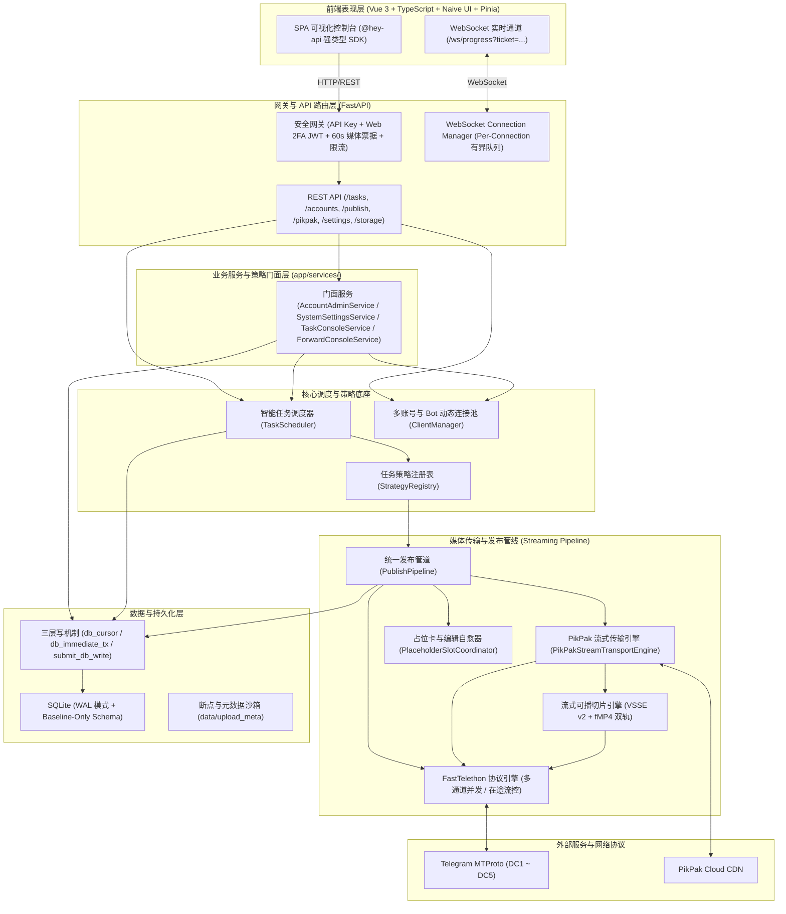

# 🏛️ TG-Media-Hub 系统总体架构与核心术语 (Architecture Overview)

本文档面向系统架构师与核心开发者，阐述 TG-Media-Hub 的单向分层架构、依赖红线、核心子系统、安全模型以及专业术语词典。

---

## 1. 系统总体架构全景与分层红线 (High-Level Architecture)

TG-Media-Hub 采用严格单向分层（`app/api/` → `app/services/` → `app/core/` → `app/db/`）与事件响应式混合架构，整体分为六大核心层级：

### 1.1 单向分层依赖红线与 AST 静态守卫
系统严格执行四层单向依赖规则，并由 `scripts/lint_standards.py`、`tests/db/test_repository_domain_split.py` 与 ruff 在 CI 中强制 AST 扫描校验：
1. `app/db/`（领域仓储与写线程池）：严禁反向导入 `app/core`、`app/services` 或 `app/api`；
2. `app/core/`（调度器、连接池、传输引擎、流水线抽象）：**严禁反向导入** `app/services` 或 `app/api`；
3. `app/services/`（业务服务与任务策略执行器）：**严禁反向导入** `app/api`；
4. `app/api/`（REST 路由与网关层）：**严禁直接导入任何 `app.db.*`**（含领域 Repository 与 `write_pool`），全部数据读写、系统配置与任务/转发账本操作必须经由 `app/services/` 业务门面（`AccountAdminService`、`SystemSettingsService`、`TaskConsoleService`、`ForwardConsoleService`、`PresetService`、`StorageService`、`PikPakPublisherService`）转接；
5. `app/api/` 与 `app/services/` 均严禁从 `app.db.database` 直接导入底层 `get_db` / `db_cursor` / `db_immediate_tx`；进程级运行时共享状态统一收拢至 `app/core/runtime.py`。

---

## 2. 核心子系统剖析

### 2.1 动态客户端连接池管理器 (`ClientManager`)
- **多 Userbot 账号并发**：支持配置并维护多个独立的 Telegram 账号实例（primary / secondary 主备分级），隔离 Session 会话凭据与拟人化设备指纹；新增 Userbot 强制绑定规范化手机号，验证码登录挑战按账号串行校验，恢复连接时会校验 `user_id`（首次绑定前校对规范化会话手机号）一致后才标记 `AUTHENTICATED`；
- **Bot 轮询池 (Bot Pool)**：维护辅助 Bot 组（默认推荐 4 个），利用 Telegram 独立配额分担本地小文件发布与多客户端联合下载负载；
- **FloodWait 熔断与隔离自愈**：当任意客户端捕获 `FloodWaitError` 时，自动进入冷却隔离，调度引擎将流量无缝路由至其余健康账号，冷却到期后自动复位。

### 2.2 智能任务调度器 (`TaskScheduler`)
- **七态状态机与独占派发**：严密管理任务全生命周期（`pending` / `queued` $\to$ `running` $\to$ `completed` / `failed` / `paused` / `cancelled`）。任务拉取与重试重置使用 SQLite `BEGIN IMMEDIATE` 独占事务，所有任务创建统一入队并通过 `notify_new_task()` 唤醒调度器，执行器入口通过 `try_claim_executor_entry` CAS 占位锁保证绝对幂等；
- **动态容量调谐与全局下载水门**：支持全局并发任务限额（`max_global_concurrency`）、单账号任务槽位配额以及 **全局单桶 32 线程下载总闸**（`MAX_GLOBAL_DOWNLOAD_THREADS = 32`，由 `_global_download_threads` 统一记账，防止多任务并发下载时总连接数叠加失控）；
- **重试退避机制**：区分可重试网络瞬态异常（`RetryableTaskError`，指数退避重试）与业务致命异常（`FatalTaskError`，立即终止）。

### 2.3 `FastTelethon` 极速传输协议栈
- **读写分离并发通道**：下载支持 `1 ~ 32` 条并行 MTProto TCP 通道（默认 `8`~`16`，遇跨 DC 文件自动迁移）；上传支持 `1 ~ 16` 条并行通道（默认 `2`，直连账号主 DC）；
- **Pipelining 在途流控**：单上传连接在途未确认分块数由 `upload_in_flight_per_connection` 控制（范围 `1 ~ 4`；PikPak 流式默认 `1`，本地发布默认 `2`），填满高延迟链路带宽；
- **断点续传沙箱**：下载基于 `.part` / `.meta` 位图文件恢复，上传基于 `data/upload_meta/` 下的 `.upload.meta` 实现 2 小时 TTL 断点续传与过期自愈。

### 2.4 统一发布流水线与流媒体切片底座
- **发布流水线 (`PublishPipeline`)**：详见 [统一发布流水线与占位卡自愈](PUBLISH_PIPELINE.md)，采用模板方法与四正交策略接口编排本地目录发布与 PikPak 云端直链流式发布；
- **零落地流媒体与双轨切片**：详见 [流媒体中继与可播分卷切片引擎](STREAMING_AND_SPLITTING.md)，超限视频自动路由至 `vsse_with_fallback`（纯 Python 虚拟外包络，依赖 `app/core/iso_bmff/`）或 `fmp4_universal`（`ZeroDiskFmp4StreamUploader` + `MkvCuesProber` / `Mp4StssProber` 关键帧探测模块 + `app/core/iso_bmff/fragmented.py` 首块全局 `sidx` 回填）。

### 2.5 控制面统一 HTTP 传输层 (CDN Transport)
- **全局会话单例与代理热重载**：通过 `get_cdn_session()` 提供双检加锁懒加载的 `aiohttp.ClientSession` 单例（由 `app.main.lifespan` 挂接 `aclose_cdn_session` 关停）；优先读取动态配置 `system_settings.pikpak_proxy_url`（回退 `PIKPAK_PROXY_URL`），代理变更时自动通过 `ProxyConnector.from_url` 热重建连接池，并强制 `trust_env=False` 隔离宿主机环境代理；
- **双 Profile 超时与连接复用**：媒体探测（`MkvCuesProber`、`Mp4StssProber`）采用 `cdn_bulk_timeout`（`total=None, sock_read=15.0s`）；存活预检与缩略图拉取采用 `cdn_liveness_timeout`（`total=10.0s`），预检显式排空响应体以直接复用 Keep-Alive 连接。

---

## 3. 安全模型 (Security Architecture)

1. **凭据非公开隔离与平滑兼容**：新建 `.session` 数据库默认收拢至沙箱 `data/` 目录并应用 POSIX `0600` 权限保护；
2. **本机免认证边界与公网锁定**：本机豁免要求回环绑定、数字回环对端、无转发标记且未启用 `CONSOLE_REQUIRE_API_KEY`。公网反代与官方 Compose 启用此策略，缺少 Key 时业务返回 `503 console_locked`，受保护的首次绑定、最小公开状态、首页、静态资源与健康检查保持可达；
3. **双层 Header 门禁与短时效媒体票据**：开启 `API_KEY` 保护时，除 `/api/auth/status` 及登录引导接口外，全量业务路由强制要求 `X-API-Key` + 24 小时有效期 Web 2FA JWT（`X-2FA-Token`）；`<video>` 媒体流（`/api/storage/preview`、`/api/storage/download`）与 WebSocket 握手（`/ws/progress`）统一通过 `POST /api/auth/media-ticket` 签发 60 秒 TTL 票据（`?ticket=<ticket>`），严禁 URL 明文携带长期凭据；`/metrics` 为受保护入口（key 模式须 `X-API-Key`），`/docs` `/redoc` 仅本机可达，`/openapi.json` 本机或凭 `X-API-Key` 可读；
4. **反向代理 IP 白名单**：限制 `X-Forwarded-For` 仅从 `TRUSTED_PROXIES` 可信 CIDR 网段解析（显式拒绝 `*`），防止伪造 IP 突破滑动窗口限流；
5. **路径逃逸与空字节防护**：全量文件发布与存储接口均搭载规范化路径校验（`validate_safe_folder_path` / `validate_safe_path`），拦截 `../` 逃逸、空字节 `\x00` 及受限系统目录访问。

---

## 4. 核心专业术语速查表 (Glossary)

| 领域 | 术语名称 | 架构定义与技术要点 |
| :--- | :--- | :--- |
| **连接池与传输** | **Userbot (用户机器人)** | 基于手机号登录的 MTProto 客户端。拥有更大的单文件上传上限（普通账号最多 4,000 块 × 512 KiB = `2000 MiB (1.95 GiB)`，Premium 账号最多 8,000 块 × 512 KiB = `4000 MiB (3.91 GiB)`），且支持读写受限私有频道。 |
| **连接池与传输** | **Bot 池 (Bot Pool)** | 多个辅助 Bot Token 组成的并发轮询池，利用独立配额分担本地小文件（$\le 30\text{MB}$）发布与联合下载压力。 |
| **连接池与传输** | **全局下载线程水门** | `TaskScheduler` 内置的 `MAX_GLOBAL_DOWNLOAD_THREADS = 32` 总闸，限制所有活跃下载任务叠加的 MTProto 线程总数 $\le 32$。 |
| **连接池与传输** | **静默中转群借壳加速** | `TransitBridgeService`：主 Userbot 将受限大文件转发至私密中转群，`1 Userbot + N Bots` 并发从群内拉取分片，完成后在 `finally` 中物理删除中转消息。 |
| **流媒体与切片** | **零磁盘落地 (Zero-Disk)** | 从上游（PikPak CDN）读取的数据流经有界内存队列直接转发至 Telegram MTProto，全程不在宿主机磁盘或 `/dev/shm` 落盘媒体文件。 |
| **流媒体与切片** | **L1 容灾环形缓存** | 内存中开辟的有界滑动窗口（默认 50MB），用于吸收网络 ACK 抖动，并在短暂 `FloodWait` 或断线重连期间保护已读未确认的数据块。 |
| **流媒体与切片** | **VSSE v2** | 虚拟流式 MP4 外包络重构引擎。纯 Python 在内存中基于 ISO-BMFF 盒树重写样本表与 HTTP Range 映射，0% CPU 占用、内存 $< 15\text{MB}$。 |
| **流媒体与切片** | **fMP4 全能保底 (`fmp4_universal`)** | 基于 FFmpeg `pipe:1` 的零落盘分卷管道（`-c:v copy`、音频转 AAC），在第 0 块预留 64 KiB 回填全局 `sidx` 索引与四处时长，确保全平台秒开拖动。 |
| **流媒体与切片** | **音画同步 SAP/RAP 对齐** | 探测真实关键帧使切分点与关键帧重合（$S = K$），配合 `-noaccurate_seek` 与 $+0.18\text{s}$ Demuxer 正向超调量，彻底消除跨卷切口声画错位。 |
| **流水线与转发** | **占位卡与原地回填** | 多集发布中途单集失败时，先发 16:9 暗底 ⏳ 海报卡锁定集数槽位；重试成功时通过 CAS 抢锁（`placeholder_sent -> editing`）并调用 `editMessageMedia` 原位替换为正式视频。 |
| **流水线与转发** | **覆盖区间账本与二分隔离** | `ForwardService` 记录已转发消息 ID 连续区间（如 `[1-500, 601-1000]`）以计算遗漏断档（Gaps）；批量转发遇坏消息时按 $O(\log N)$ 递归二分隔离问题消息 ID。 |
| **流水线与转发** | **结构化保留式归档 (`dir_tree`)** | PikPak 发布完成后，按源目录相对路径映射在远端网盘 `[已发布归档]` 下递归创建镜像目录并移动文件，自底向上清理空源目录。 |
