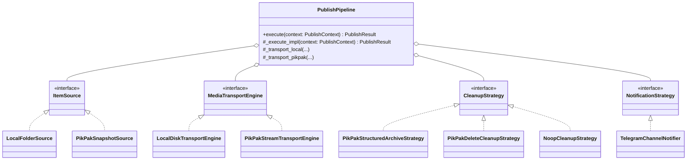
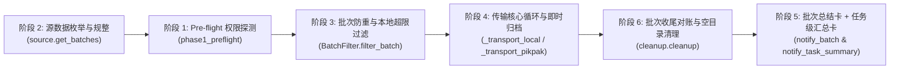
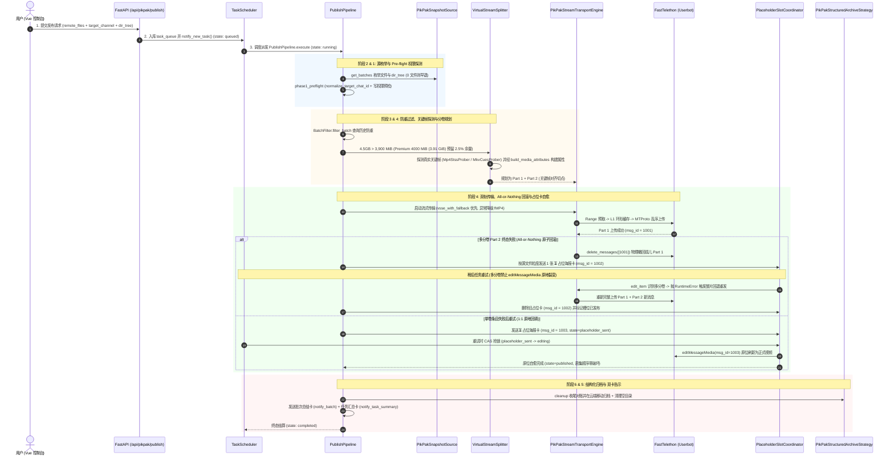
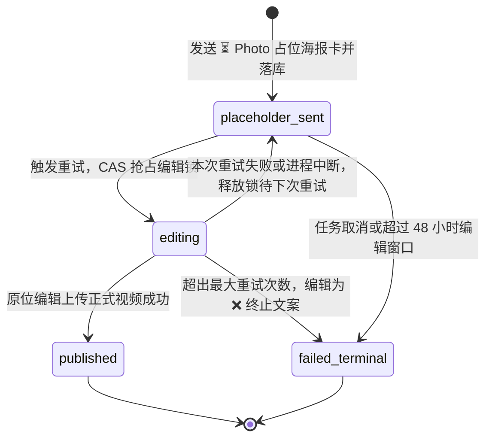

# 📦 统一发布流水线、全链路时序与占位卡自愈 (Publish Pipeline & Self-Healing)

本文档面向系统架构师与后端开发者，完整阐述 TG-Media-Hub 核心发布流水线（`PublishPipeline`）的四正交策略模型、六阶段生命周期、4.5GB 超限视频全链路时序、传输引擎内部分层以及媒体占位卡（`PlaceholderSlotCoordinator`）原地编辑自愈机制。

---

## 1. 架构定位与四正交策略模型

系统同时支持 **本地文件夹批量发布** 与 **PikPak 云端直链免落盘发布**。为彻底消除两套流程在权限预检、频道解析、防重过滤及总结卡发送上的逻辑漂移，系统采用 **模板方法模式 (Template Method)** 搭配 **四维策略组合 (Strategy Composition)**：

- **模板方法 (`PublishPipeline.execute`)**：公共入口为 `execute(context)`（内部委派 `_execute_impl`），管控 6 阶段标准生命周期，统一处理异常熔断、双量纲进度广播、逐文件防重累加（`skipped_bytes_acc`）及频道会话刷新；
- **四正交策略接口 (`app/core/pipeline/interfaces.py`)**：
  1. `ItemSource`：源数据枚举与元数据抓取（本地目录扫描 `LocalFolderSource` vs 网盘快照 `PikPakSnapshotSource`）；
  2. `MediaTransportEngine`：媒体流传输驱动（本地磁盘直传 `LocalDiskTransportEngine` vs 零落盘流式切片 `PikPakStreamTransportEngine`）；
  3. `CleanupStrategy`：资产归档与清理（结构化远端归档 `PikPakStructuredArchiveStrategy`、远端回收站清理 `PikPakDeleteCleanupStrategy` vs 本地无损空操作 `NoopCleanupStrategy`）；
  4. `NotificationStrategy`：频道批次总结卡与任务级汇总卡告示（`TelegramChannelNotifier`）；
- **双门面装配 (`app/services/publish_runner.py`)**：外部调用方通过 `PublisherService` 与 `PikPakPublisherService` 组装对应策略与默认端口适配器（`ClientRegistryPort` / `TaskStorePort`）并调用 `PublishPipeline.execute(context)`。

---

## 2. 标准六阶段生命周期与全链路端到端时序

### 2.1 六阶段真实执行顺序
为支持“空目录零探针早退”与“批次总结卡内嵌归档统计”，6 个逻辑阶段按以下真实顺序执行（**阶段 2 先于阶段 1；单批次内阶段 6 先于阶段 5**）：

- **阶段 2（源数据枚举前置）**：调用 `self.source.get_batches(context)` 统计总文件数；若为 `0` 文件直接早退返回成功，避免无意义的 Telegram RPC 探针。PikPak 发布在此阶段同步构建 `{folder_id: rel_path}` 相对路径映射（`dir_tree`）；
- **阶段 1（Pre-flight 权限探测）**：调用 `normalize_target_chat_id` 将 9~12 位正整数频道 ID 自动补齐 `-100` 转为负整数 `int`，未缓存私有频道 `access_hash` 时自动通过 `get_dialogs(limit=50)` 刷新，并校验 Userbot 是否具备 `creator` 或管理员 `post_messages` 权限；
- **阶段 3（防重过滤与本地超限拦截）**：查询 `publish_history` 跳过已发布文件并累加 `skipped_bytes_acc`。本地发布（`LocalFolderSource`）在此阶段按账号单文件上限（普通账号 `2000 MiB (1.95 GiB)` / Premium 账号 `4000 MiB (3.91 GiB)`）执行 `skip_and_report` 或 `strict_fail` 拦截；PikPak 发布（`PikPakSnapshotSource`）则将超限切片判定延迟至阶段 4；
- **阶段 4（传输核心循环与即时归档）**：
  - `LocalDiskTransportEngine`：不超过 `userbot_upload_threshold_mb`（默认 30 MB）的小文件派发至 Bot Pool 轮流推流，大文件或占位卡原地回填走 Userbot；
  - `PikPakStreamTransportEngine`：**全程 100% 强制使用 Userbot** 执行零落盘流式上传；当文件超过切分阈值（预留 2.5% 余量：普通号 1,950 MiB / Premium 3,900 MiB）且策略为 `split` 时，自动路由至 `vsse_with_fallback` 或 `fmp4_universal` 双轨切片引擎；
  - 单文件/相册发送成功即刻调用 `cleanup.archive_single_item`，并独立广播条目级（`processed_items / total_items`）与字节级（`processed_bytes / total_bytes`）双量纲进度；
- **阶段 6（资产清理善后与对账）**：本地发布固定绑定 `NoopCleanupStrategy`（绝不移动本地源文件）；PikPak 发布绑定 `PikPakStructuredArchiveStrategy` 或 `PikPakDeleteCleanupStrategy`，对未即时归档项兜底对账并自底向上清理已搬空的源子目录；
- **阶段 5**：文件夹发布且存在新发成功、失败或超限跳过文件时发送批次总结卡（`notify_batch`，内嵌阶段 6 归档统计）；全部批次结束后发送任务级全局汇总卡（`notify_task_summary`）。

### 2.2 全链路端到端时序图（以 4.5GB PikPak 4K 视频为例）

---

## 3. 传输引擎内部分层 (`app/core/pipeline/engines/`)

传输引擎子域按 **门面路由 → 所有权归位 → 端口注入** 三层组织：

| 模块路径 | 所有权定位 | 核心职责说明 |
| :--- | :--- | :--- |
| `interfaces.py` | 端口契约 | 定义 `ClientRegistryPort` 与 `TaskStorePort` Protocol；默认参数绑定单例适配器，使 engines 包内对 `TaskQueueRepository` 与 `client_manager` 的直接引用归零 |
| `engines/pikpak/engine.py` | 门面路由 | `PikPakStreamTransportEngine` 门面：`send_item` / `send_album` / `edit_item` 路由委托、JIT 索链与 CDN Range 206 预检、封面工厂、VSSE/fMP4 双轨分卷编排 |
| `engines/pikpak/single.py` | 单发/相册/回填 | `send_item` 策略路由、`send_album` 图片相册（预取窗口逐项隔离上传 → 组发矩阵）、`edit_item` 原地回填（拦截多分卷抛出 `RuntimeError`）、`raw` 物理分卷上传 |
| `engines/pikpak/vsse.py` | Tier 1/2 主通道 | `probe_vsse_envelope`（Tier 1 纯零拷贝 / Tier 2 混合旁路音轨分流）与 `VsseSplitChannel`（信封头合成 + 虚拟信封流式分卷发送） |
| `engines/pikpak/fmp4.py` | Tier 3 保底通道 | `probe_fmp4_media`（Cues/STSS 关键帧轴 + 共享元数据回填）与 `Fmp4SplitChannel`（动态分卷规划 + 超限重规划 + 管道流式上传） |
| `engines/pikpak/split_loop.py` | 分卷主循环模板 | `execute_split_loop`：检查点幂等跳过、JIT 跨卷索链刷新、分卷间呼吸等待（`BreathingPolicy` 注入）、非惩罚性保全 vs 物理回滚判定矩阵 |
| `engines/local_disk.py` | 本地磁盘子域 | `LocalDiskTransportEngine`：按体积阈值路由 Userbot 或 Bot Pool；本地视频属性探测缓存（`(path, size, mtime)` 键控 128 项 LRU，走 `Mp4StssProber` / `MkvCuesProber`） |
| `engines/_common.py` & `_types.py` | 共享小件与协议 | `ProgressReporter`、CDN Range 预检、元数据回填器 `_backfill_media_metadata_to_item` 以及 `SplitChannel` / `SplitVolumePlan` / `VolumeJob` 契约 |

---

## 4. 媒体占位卡与原地编辑自愈 (`PlaceholderSlotCoordinator`)

在向频道连续发布多集剧集（如 24 集连续剧）时，若第 2 集因网络瞬断失败而第 3、4 集正常发出，传统追加重发会导致剧集顺序错乱为 `[1, 3, 4, ..., 2]`。系统通过 **“先发 16:9 暗底占位海报卡锁定槽位，重试时通过 `editMessageMedia` 原位替换为正式媒体”** 实现广播级时序自愈。

### 4.1 槽位状态机 (`placeholder_slots`) 与 CAS 并发保护

- **CAS 原子抢锁**：重试时仅当 `state IN ('placeholder_sent', 'failed_terminal')` 才允许原子变更为 `editing`，杜绝多协程重复编辑同一消息；
- **进程崩溃孤儿恢复**：服务启动执行 `recover_orphaned_tasks` 时，自动将挂起在 `editing` 状态的槽位回滚至 `placeholder_sent`。

### 4.2 卡片形态矩阵与防刷屏封顶（10 + 1 保护）

| 故障类别 | 发送卡片形态 | 媒体类型 | 是否可原地回填 | 终态演进行为 |
| :--- | :--- | :--- | :---: | :--- |
| **单文件上传失败（单卷）** | ⏳ 独立占位卡 | Photo (暗底 16:9 海报) | **是** | 重试成功后通过 `editMessageMedia` 原位刷新为正式视频 |
| **多分卷文件上传失败** | ⏳ 独立占位卡（每源文件 1 张） | Photo (暗底 16:9 海报) | **否（整片重发）** | 失败时先 `delete_messages` 撤回孤儿分卷再发 1 张占位卡；重试时整片重发全部分卷并删除旧占位卡 |
| **相册部分成员失败** | ⏳ 独立占位卡 | Photo (暗底 16:9 海报) | **是** | 成功成员正常以相册组发，失败成员原位回填 |
| **相册整组全部失败** | ⚠️ 整组汇总卡 | 纯文本消息 | **否** | 整组走常规重新组发；原卡片文案翻转为“已在下方补发” |
| **业务规则拦截 (Reject)** | 零发卡 | - | - | 文件命名或格式不符合规则，不发卡，仅在后台记录 |

- **10 + 1 防刷屏封顶**。单次流水线运行内，逐条失败占位卡与超限说明卡合计最多 **10 张**，超过上限时发 **1 张**溢出说明卡。相册整组失败汇总单独处理。
- **回填争用**。占位卡由其他任务编辑时，当前任务排队等待 15 秒，随后复查一次。复查时仍被占用则标记失败，可在占位卡释放后手动重试。
- **静态海报资产与 `InputPhoto` 句柄复用**：默认采用 `app/assets/placeholder_poster.jpg`（1280×720 16:9 静态 JPEG，$\le 40\text{KB}$，置于 `app/assets/` 避免前端构建清空 `static/`），通过具名 `BytesIO` 发送且不发起任何外部 URL 抓取；单次运行首次上传海报后自动缓存服务端返回的 `sent_msg.photo` 句柄，后续占位卡零重复上传带宽；
- **48 小时编辑窗口兜底 (`classify_edit_failure`)**：若超过 Telegram 48 小时编辑窗口（`MessageEditTimeExpiredError`）或原占位消息已被手动删除（`MessageDeletedError` / `MessageIdInvalidError`），自动安全降级为在频道末尾追加发送并在任务日志中记录。
