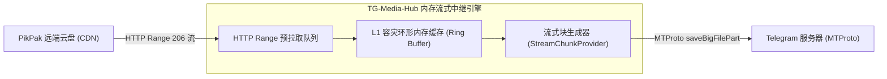
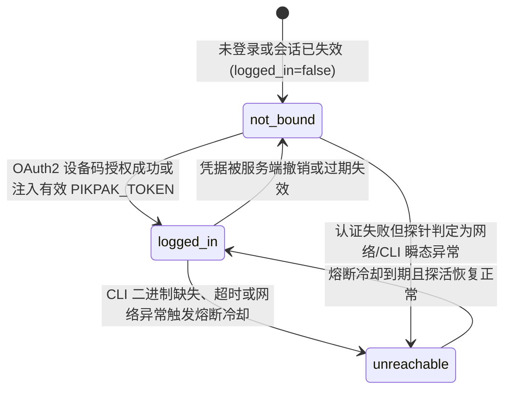
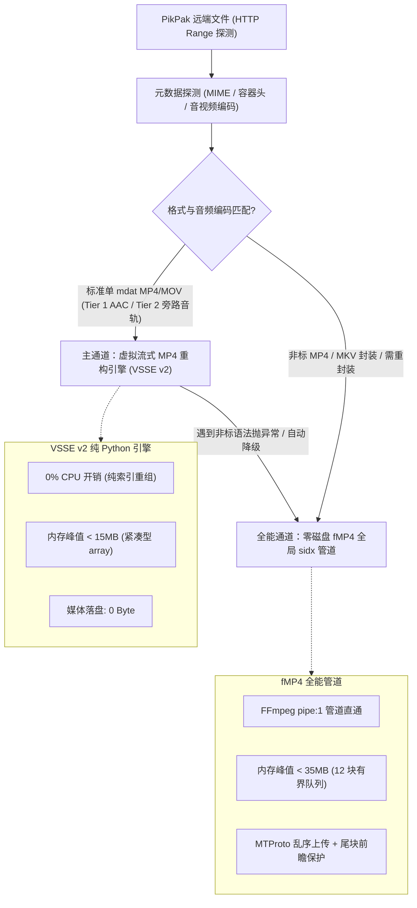

# 🎬 零落地流媒体中继与可播分卷切片引擎 (Zero-Disk Streaming & Playable Splitting)

本文档面向流媒体架构师、音视频工程师及核心开发者，系统阐述 TG-Media-Hub 的两大核心流媒体技术支柱：**PikPak 云端直链免落盘流式中继** 与 **超限大文件双轨可播分卷切片引擎（`vsse_with_fallback` + `fmp4_universal`）**。

> 💡 **架构上下文与流水线衔接**：流式切片引擎由发布流水线的阶段 4（传输核心循环）动态驱动。关于发布任务的生命周期、四正交策略装配与全链路时序，请参阅 [统一发布流水线架构 (PUBLISH_PIPELINE.md)](PUBLISH_PIPELINE.md)。

---

## 1. PikPak 云端零落地流式中继架构 (Zero-Disk Cloud Streaming)

### 1.1 设计背景与零落盘内存流管线
在低配 VPS（如 2C2G + 机械硬盘 + 空闲内存 $< 600\text{MB}$）上，传统的“先全量下载至磁盘再上传”方案会导致机械盘 I/O Wait 飙升至 80%+（锁死 SQLite）且磁盘容量迅速耗尽；若写入 `/dev/shm` 内存盘则会直接触发内核 OOM-Killer。

为此，系统实现了 **媒体字节零落盘（Zero-Disk Storage）内存流式中继架构**，严格遵循四条物理红线：**媒体数据 0 落盘、单任务内存受控在 35MB 以内、视频 0 重编码（`-c:v copy`）、产物 100% 即点即播且进度条秒开拖动**：

- **自适应 Range 预取与 L1 环形内存缓存 (`RingBuffer`)**：在内存中开辟严格有界的环形滑动窗口（默认 50MB），根据下行与 Telegram 上行 ACK 速率差发起 `Range: bytes=start-end` 预读；当上行拥塞时有界队列自然反压阻塞上游 HTTP 读取，杜绝 OOM；
- **CDN 直链 JIT 动态续约与双时钟 TTL**：在每个大文件或独立分卷开始前动态向 PikPak 索取最新直链；传输中若遇 403 / 410 / 网络瞬断，自动触发原地索链刷新（最多重试 3 次）并从断点字节继续 Range 请求；结合 `monotonic` 单调时钟与绝对时间防止系统时钟漂移误判过期。

### 1.2 PikPak 鉴权三态状态机 (`GET /api/pikpak/auth/status`)

凭据与运行状态在 `app/services/pikpak_service.py` 与 `PikPakAuthStatusResponse` 中被建模为小写三态状态机（接口恒返回 HTTP 200）：

- **`"not_bound"`**：尚未完成 OAuth2 设备码登录且未配置 `PIKPAK_TOKEN`，前端展示设备码绑定卡片；
- **`"logged_in"`**：凭据有效且探活通过，返回账号名、VIP 等级与空间统计，可执行浏览（`/api/pikpak/files/list`）、预检（`/api/pikpak/inspect`）与发布（`/api/pikpak/publish`）；
- **`"unreachable"`**：检测到 `pikpak` CLI 缺失、网络瞬断或超时进入熔断冷却，避免将网络抖动误判为“未绑定”。

### 1.3 远程目录树结构化归档 (`dir_tree`) 与零落盘自适应抽帧
- **结构化保留式归档 (`PikPakStructuredArchiveStrategy`)**：目录树映射 `{folder_id: "电视剧/第一季"}` 相对路径由前端子树选择时构建并随载荷提供（API 载荷仅收叶子文件快照，目录条目 422 拒绝）；发布完成后在网盘 `[已发布归档]` 下自动递归创建镜像目录并批量原子移动，若目标创建异常则优雅降级为平铺移入归档根目录；
- PikPak 视频先用已提供的封面字节或列表中的 `thumbnail_link`。封面缺失或无效时，执行一次 `get <file_id> --raw` 补查，仍不可用则复用上传或预检直链，用 FFmpeg 通过 HTTP Range 抽帧。本地视频由 FFmpeg 直接读取文件。封面处理共用 12 秒预算，包含排队等待，并限制跨任务的网络请求和抽帧并发。
- 抽帧时间按视频时长选择，短片的时间点限制在片长内。没有取到帧时可尝试从片头取帧，遇到近黑帧时尝试另一个时间点。FFmpeg 按显示方向等比缩放，封面输出为宽高均不超过 320 像素、大小低于 200 kB 的 JPEG。没有可用封面时使用内置静态海报。本地发送和 PikPak 占位回填均携带封面，回填失败后转为单发时可以复用该条目的封面字节。

---

## 2. 超限大文件双轨分层流式切片架构 (`SPLIT_STRATEGY`)

### 2.1 平台分块硬顶与双轨路由决策
Telegram MTProto 协议对单文件分块数存在硬性上限：
- **普通 Userbot 账号**：最多 4,000 块 × 512 KiB = **`2000 MiB (1.95 GiB)`**（2,097,152,000 字节）；
- **Telegram Premium 账号**：最多 8,000 块 × 512 KiB = **`4000 MiB (3.91 GiB)`**（4,194,304,000 字节）；
- **安全分卷阈值 (`derive_split_threshold`)**：预留 2.5% 容器头安全余量，普通号超过 **1,950 MiB**、Premium 超过 **3,900 MiB** 即触发流式可播切片。

系统采用 **“主通道 `vsse_with_fallback` 极速零拷贝 + 全能保底通道 `fmp4_universal` 兜底”** 的双轨架构（严禁静默降级为不可播放的 `raw` 硬切分卷）：

---

## 3. 主通道：虚拟流式 MP4 重构引擎 (`VSSE v2`)

针对标准 MP4 / MOV 容器，`app/core/vsse_provider.py` 与 `app/core/iso_bmff/` 提供纯 Python 的内存指针映射，无需启动 FFmpeg 进程：

1. **紧凑型内存模型 (`< 15MB`)**：采用 `array.array('I')` 连续内存存储样本大小与偏移量，3 小时 60fps 视频的元数据驻留增量仅约 4.6MB；
2. **虚拟外包络切片 (`VirtualEnvelopeChunkProvider`)**：计算目标分卷对应的样本索引区间 $[i_{start}, i_{end}]$，提取物理区间外包络 $[O_{min}, O_{max}]$ 直接映射为 HTTP Range 请求；
3. **标准 32 字节 `ftyp` 头与双层音画对齐（Tier 1 / Tier 2）**：
   - 合成头部严格对齐 32 字节 `ftyp` 盒与重写后的 `moov`（强制使用 64 位 `co64` 块偏移与 1-based `stss` 关键帧表）；
   - 提取源音轨预滚延迟（Priming Delay），通过 `moov.trak.edts.elst`（含 Empty Edit 与 Media Rate 精确补偿）消除跨卷切口处的音画偏差；
4. **盒跨度跳跃探测与零延迟熔断降级**：扫描顶层 Box 跨度时若发现多 `mdat`、`mvex` 碎片盒或无法处理的非标布局，立即抛出 `UnsupportedMp4LayoutError`，流水线无缝回退至 `fmp4_universal` 通道。

---

## 4. 全能保底通道：`ZeroDiskFmp4StreamUploader` (`fmp4_universal`)

针对 MKV / WebM / TS 容器或含 DTS / AC3 等非标音轨的媒体，`ZeroDiskFmp4StreamUploader` 将视频流 `-c:v copy`、音频按需转码为 AAC 输出至 `pipe:1`，并利用 MTProto `upload.saveBigFilePart` 支持 `file_total_parts = -1` 与分块乱序上传的特性实现零落盘直传。

### 4.1 六项生产级安全保障机制
1. **单块前瞻缓冲（1-Chunk Lookahead）**：始终在内存中扣留最新 1 个 512 KiB 分块（`pending_chunk`），仅当后续读到新字节时才将前一块以 `file_total_parts = -1` 发出；遇到 EOF 时将该 `pending_chunk` 作为尾块声明真实 `total_parts`，彻底根除流大小恰为 512 KiB 整数倍时触发的 `FILE_PARTS_INVALID`；
2. **顶层 Box 扫描防短读与 64 位大盒兼容**：管道读取使用 `readexactly(8)` 捕获 `IncompleteReadError`，遇到 `box_size == 1` 时读取 8 字节 `largesize`（uint64）；
3. **四处时长同步安全刷新**：递归遍历 Box 树，同步回填 `mvhd`、各轨道 `tkhd`、`mdhd` 以及 `mvex.mehd` 的真实总时长；
4. **首块 64 KiB 预留与全局 `sidx` 回填**：在 `file_part=0` 预留 64 KiB 空间，流式汇总各分片 duration ticks 后回填全局 `sidx` 索引表与 `free` 占位盒，解决 iOS AVPlayer、macOS QuickTime 与 Android ExoPlayer 进度条归零或无法拖动的问题；
5. **异步排空 `stderr` 防管道死锁**：后台协程持续排空 FFmpeg 子进程 `stderr`，防止长视频日志填满 OS 管道缓冲区挂死进程；
6. **全局并发信号量限制**：通过模块级 `asyncio.Semaphore(2)` 限制全局并发 FFmpeg 进程数 $\le 2$。

### 4.2 分片策略与 SAP 不变量 (`-min_frag_duration 2000000`)
- **关键帧起始分片**：FFmpeg 命令采用 `-min_frag_duration 2000000` 配合 `frag_keyframe`，使每个 fMP4 分片只在视频关键帧处开启（且距上一分片起点 $\ge 2\text{s}$），确保每个分片的首视频样本均为关键帧（SAP），消除客户端 seek 后的花屏撕裂；
- **如实标记 `starts_with_SAP`**：解析每个 `moof` 中视频轨 `trun` 的 `first_sample_flags`（契约值 `0x02000000`）如实写入 `sidx`，并在首次构建命令时执行模块级缓存的 `ffmpeg -h muxer=mp4` 能力预检。

---

## 5. 音画同步（A/V Sync）机理：切点对齐 ($S = K$) 与正向超调量

在不重编码视频（`-c:v copy`）的硬约束下，视频切点受限于关键帧（GOP 量化，精度 1~5s），而音频转码精确到采样点（毫秒级）。若按纯时间盲切，视频自动回退到前一个关键帧 $K$，音频从时间戳 $S$ 截取，必然产生 $|S - K|$ 的音画错位。

系统通过双重机制从根源消除错位：
1. **预探测真实关键帧 ($S = K$)**：规划期通过 `MkvCuesProber`（MKV/WebM）或 `Mp4StssProber`（MP4/MOV）提取远程媒体的关键帧时间戳表，将分卷切点强制选定在真实关键帧上；
2. **`-noaccurate_seek` 与正向超调量 $\epsilon = +0.18\text{s}$**：
   - `-noaccurate_seek` 消除 FFmpeg 默认精准 Seek 引入的约 150ms 解码端音频前置修剪延迟；
   - `seek_sec = start_sec + 0.18` 正向超调量彻底防止 MKV 解复用器因浮点精度在关键帧边界回退至上一关键帧（Demuxer N-1 fallback）引发的数秒画面重复或空洞。

---

## 6. E2E 捕获取证模式 (`E2E_CAPTURE_MODE`)

生产模式下流式切片严格零落盘；当显式开启 `E2E_CAPTURE_MODE=true`（需重启）时，系统为每个发布条目在 `E2E_CAPTURE_DIR`（默认 `data/e2e_capture`）留存三份证据供离线取证：
1. **E1 源快照**：独立 provider 全量顺序下载源文件；
2. **E2 切分产物**：挂接在上传流内（VSSE 走 provider 装饰 tee 并强制 `force_fresh`，fMP4 走伴随入队的 capture sink），证明“实际上传的即是这些字节”；
3. **E3 Telegram 镜像**：发布后由 `scripts/e2e_tg_mirror.py` 离线回拉，并由 `scripts/e2e_compare.py` 执行 A1~A5 五项断言对比（详见 [E2E 验证指南 §5.1](../testing/E2E_GUIDE.md)）。
