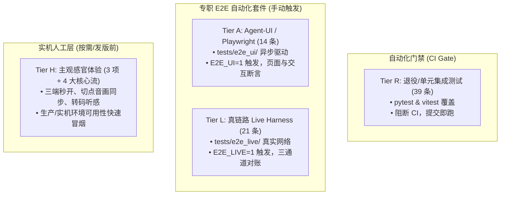

# 🧪 TG-Media-Hub 端到端验证与验收指南 (E2E Testing Guide)

本文档面向测试工程师、系统实施人员与开源贡献者，是 TG-Media-Hub 的**统一端到端（E2E）质量保证全景指南**。它兼顾了基于真实账号的**实机人工快速冒烟**与覆盖系统深度重构的**全量自动化用例矩阵真源**。

---

## 0. 测试体系全景 (Four-Tier Testing System)

为避免低效冗长的人工回归，系统自 2026-10 起全面采用**四层 E2E 治理体系**。所有 70+ 条历史回归用例均已归入对应层级：



- **R 层（自动化退役）**：纯业务逻辑、参数校验与接口契约，已固化在常规 `tests/` 单元测试中，由 CI 自动门控。
- **L 层（Live 真链路）**：涉及真实的 Telegram MTProto 交互与 PikPak 远端网络，由 `tests/e2e_live/` 在受控环境触发。
- **A 层（UI 自动化）**：前端视图路由、响应式状态与表单保持，由 `tests/e2e_ui/`（Playwright）执行。
- **H 层（人工感官残留）**：涉及播放器首帧延迟、切点音画同步与主观听感，保留人工实机抽检。

---

## 1. 快速实机冒烟与感官验收 (Manual Sanity & Sensory)

面向部署完成或大版本发版前的实机人工验收，耗时约 15~30 分钟。

### 1.1 环境与前置准备
| 角色 | 状态要求 | 业务职责 |
| :--- | :--- | :--- |
| **主 Userbot** | 已登录且正常就绪（建议同时具备普通号与 Premium 号） | 发送占位卡、执行原地 edit 回填、超限大文件切片传输 |
| **Bot Pool** | 轮询池中有 $\ge 2$ 个有效 Bot | 小文件正式媒体并发轮流发送 |
| **测试频道** | 私密测试频道（如 `E2E-Test`） | Userbot 必须具备管理员发帖权限，Bots 需具备发帖权限 |
| **PikPak 账号**| 状态为 `VALID` 且有可用容量 | 云端免落盘流式发布与归档 |

### 1.2 4 大核心业务流验收
1. **场景 1：失败可感知（⏳ Photo 占位卡生成）**
   - **操作**：提交 2 个视频的发布任务；在第 2 个文件上传中人为中断网络 10 秒后恢复。
   - **断言**：频道内生成 16:9 标准暗底占位海报卡，附带失败原因；任务中心标记为 `⏳ 占位待回填`；集数序号不中断。
2. **场景 2：原地编辑自愈（✅ Edit 回填与无序重修）**
   - **操作**：在控制台找到上述失败任务，点击「重试」。
   - **断言**：频道原占位卡被 Telegram Edit API 原地更新为正式视频，**原消息 ID 保持不变**；频道底部无孤儿消息。
3. **场景 3：PikPak 免落盘零磁盘流式发布**
   - **操作**：在 PikPak 工作台选择远程文件夹，选择结构化归档并提交发布；监控宿主机。
   - **断言**：宿主机 `/app/downloads` 零临时文件暴涨；内存增量稳定在预算内（单任务 < 35MB）；发布后远端网盘文件移动至归档目录并保留层级。
4. **场景 4：超限大文件流式切片发布**
   - **操作**：准备超过 Telegram 单文件限制（普通号 `2000 MiB (1.95 GiB)` / Premium `4000 MiB (3.91 GiB)`）的大文件提交流式发布。
   - **断言**：自动切分且各分卷以原生视频卡片形态呈现（非裸二进制文件）；分卷标题规范标注序号与总数。

### 1.3 H 层主观感官体验检查
- **H-01 分卷三端即点即播与首帧流畅度**：在 Telegram Desktop、iOS 与 Android 客户端点击超限分卷视频，验证起播时间 < 3s，进度条可任意拖动不卡死。
- **H-02 分卷切点音画同步逐帧观感**：以 0.5x 慢速播放分卷衔接处（Part 1 尾部与 Part 2 头部），肉眼和耳朵确认画面无停滞、音画严格对齐。
- **H-03 fMP4 转码后音质听感**：针对非 AAC 音轨源（如 AC3/E-AC3）经 FFmpeg 管道转码的分卷产物进行试听，确认无破音、底噪或声道丢失。
- **H-04 冷启动引导链（默认 Userbot 准入）**：以全新空数据目录冷启动服务，确认浏览器首屏为部署者引导屏；分别以 QR 扫码与 OTP 验证码双通道各完成一次默认账号绑定（含开启两步验证密码的账号），准入后控制台全链路可用；引导中断重启后二维码保持；错误引导密钥被明确拒绝。
- **H-05 公网控制台锁定矩阵**：公网入口无 `API_KEY` 时业务页面呈现锁定屏且 WebSocket 断开（1008）；配置 `API_KEY` 并携带凭证后全链路放通；`CONSOLE_REQUIRE_API_KEY=false` 时本机回环直连保持免认证，`CONSOLE_REQUIRE_API_KEY=true` 时回环请求同样执行公网认证/锁定策略；回环反代漏转发头时按公网处理（锁定）；仅残留 `TG_API_KEY` 而未配置 `API_KEY` 时启动快速失败并提示改名，两者并存时启动放通并输出弃用告警。
- **H-06 移动端真机巡检**：真手机浏览器（视口 ≤768px）巡检任务中心移动卡片流、批量操作栏最后任务可达、创建流三 Tab、详情抽屉高度受控（约 88dvh）与刘海屏 safe-area。
- **H-07 封面与准入目检**：真 Telegram 客户端确认视频消息携带封面；全黑片源封面回退占位海报而非黑帧；透明图无白底伪影；存储页 `.m4v` 出现在媒体预览；发布提交前修改目标文件夹被门禁拦截。

---

## 2. 自动化 E2E 套件运行指引 (Automated Suites)

### 2.1 Playwright UI 自动化套件 (`tests/e2e_ui/`)
基于 Python `playwright.async_api` 驱动，验证 Web 控制台 8 大页面交互与状态机。
```bash
# 全量执行 UI 自动化（默认 Headless）
E2E_UI=1 uv run pytest tests/e2e_ui/ -v

# 开启浏览器可视化窗口运行（便于调试观察）
E2E_UI=1 E2E_UI_HEADLESS=0 uv run pytest tests/e2e_ui/ -v

# 运行单模块
E2E_UI=1 uv run pytest tests/e2e_ui/test_ui_core.py -v
```

### 2.2 Live 真网络链路套件 (`tests/e2e_live/`)
拉起真服务器进程 + scratch 隔离 `DATA_DIR` + 断言三通道（REST / DB / Telethon 客户端）。**默认 skip，绝不进 CI**。
```bash
# 执行前务必先停止本地正在运行的 tg_service，避免 session 锁冲突
set E2E_LIVE=1
uv run pytest tests/e2e_live -q --tb=short
```

### 2.3 测试沙箱隔离红线
测试套件由 `tests/conftest.py` 严格沙箱化：全量运行 `uv run pytest` 后，`data/` 与根目录不得产生任何新增的 `.session`、`.db`、`-wal` 或临时下载文件。

---

## 3. 全量 E2E 用例真源矩阵 (Comprehensive Case Matrix)

本矩阵是系统全量 73 条回归用例的规格定义与处置真源（SSoT）。

### 模块 A：切片策略配置全链路 (`E2E-CFG`)
| 编号 | 优先级 | 目标与场景 | 处置 | 覆盖与判定依据 |
| :--- | :---: | :--- | :---: | :--- |
| `E2E-CFG-01` | P0 | 前端策略选择器动态显隐 | **A** | `tests/e2e_ui/test_ui_pikpak.py` (E2E-UI-12) |
| `E2E-CFG-02` | P0 | 提交载荷契约与非 split 过滤 | **A** | `tests/e2e_ui/test_ui_pikpak.py` (E2E-UI-12) |
| `E2E-CFG-03` | P1 | 后端非法策略枚举拦截 (422) | **R** | `tests\api\test_pikpak_api.py::test_schema_validation_422` |
| `E2E-CFG-04` | P0 | 参数持久化与调度器透传 | **R** | `tests\api\test_pikpak_api.py` + `tests/services/test_task_strategies.py` |
| `E2E-CFG-05` | P1 | 任务级策略覆盖全局设置不回写 | **R** | `tests/services/test_task_strategies.py` |
| `E2E-CFG-06` | P1 | 缺省策略回落与数据库自愈 | **R** | `tests\api\test_settings_api.py::test_pikpak_default_split_strategy_database_self_healing` |
| `E2E-CFG-07` | P1 | 设置中心热生效（新任务生效/旧任务锁定） | **R** | `tests\api\test_settings_api.py` + `tests/services/test_task_strategies.py` |
| `E2E-CFG-08` | P2 | 设置项非法值双端拦截 (400) | **R** | `tests\api\test_settings_api.py` |
| `E2E-CFG-09` | P2 | 环境变量非法值启动期快速失败 | **L** | `tests/e2e_live/test_00_preflight.py` (E2E-LIVE-01) |
| `E2E-CFG-10` | P1 | `raw` 硬切策略生成 `.part001` 二进制形态 | **L** | `tests/e2e_live/` (E2E-LIVE-11) |

### 模块 B：VSSE 零重编码主通道 (`E2E-VSSE`)
| 编号 | 优先级 | 目标与场景 | 处置 | 覆盖与判定依据 |
| :--- | :---: | :--- | :---: | :--- |
| `E2E-VSSE-01` | P0 | 标准 faststart MP4 主通道全流程（零 ffmpeg） | **L** | `tests/e2e_live/` (E2E-LIVE-07)；日志断言 `🚀 VSSE 分卷发布成功` |
| `E2E-VSSE-02` | P0 | rear-moov（moov 后置）先拉尾部两遍解析 | **L** | `tests/e2e_live/` (E2E-LIVE-08) |
| `E2E-VSSE-03` | P0 | 非标 box 布局熔断降级至 fMP4 | **L** | `tests/e2e_live/` (E2E-LIVE-09)；断言 `⚡ [CIRCUIT BREAKER]` |
| `E2E-VSSE-04` | P0 | DTS/AC3 音频 pre-flight 自动路由至 fMP4 | **L** | `tests/e2e_live/` (E2E-LIVE-10) |
| `E2E-VSSE-05` | P1 | 非白名单视频编码降级路由 | **R** | `tests/core/test_vsse_envelope.py` |
| `E2E-VSSE-06` | P0 | 分卷独立可播性与三端拖动 | **H** | 承接为 H-01 实机感官体验 |
| `E2E-VSSE-07` | P0 | 切点音画同步与帧级连续性 | **H** | 承接为 H-02 实机感官体验 |
| `E2E-VSSE-08` | P2 | 分卷封面继承与元数据提取 | **L** | `tests/e2e_live/` (E2E-LIVE-07) |
| `E2E-VSSE-09` | P1 | 512KB 分块缓存失效自愈重拉 | **R** | `tests/core/test_vsse_envelope.py` |
| `E2E-VSSE-10` | P1 | VSSE 内存预算红线（增量 < 15MB） | **L** | `tests/e2e_live/` (E2E-LIVE-07) |

### 模块 C：fMP4 全能保底通道 (`E2E-FMP4`)
| 编号 | 优先级 | 目标与场景 | 处置 | 覆盖与判定依据 |
| :--- | :---: | :--- | :---: | :--- |
| `E2E-FMP4-01` | P0 | MKV + AC3 音轨转码全流程 | **L** | `tests/e2e_live/` (E2E-LIVE-10)；音质听感承接为 H-03 |
| `E2E-FMP4-02` | P0 | 尾块前瞻保护（防止末卷 < 512KB 触发 Telegram 报错） | **R** | `tests/core/test_fmp4_split_pipeline.py` |
| `E2E-FMP4-03` | P0 | 分卷中途失败时的孤儿消息原子回滚 | **L** | `tests/e2e_live/` (E2E-LIVE-13)；断言 `✅ 已成功清理孤儿消息` |
| `E2E-FMP4-04` | P1 | 动态重规划（体积超限自动增容分卷数） | **L** | `tests/e2e_live/` (E2E-LIVE-12)；断言 `🔄 动态重规划分卷数由` |
| `E2E-FMP4-05` | P1 | Telegram FloodWait 退避与重试 | **L** | `tests/e2e_live/` (E2E-LIVE-15) |
| `E2E-FMP4-06` | P1 | 全局 FFmpeg 并发硬上限保护 | **R** | `tests/core/test_fmp4_split_pipeline.py` |
| `E2E-FMP4-07` | P2 | CDN 直链 Range 预检失败快速报错 | **R** | `tests/core/test_paged_range_proxy.py` |
| `E2E-FMP4-08` | P1 | 直链过期 JIT 自动换链刷新 | **L** | `tests/e2e_live/` (E2E-LIVE-16) |
| `E2E-FMP4-09` | P1 | VP8 等不可转码格式降级至 raw | **R** | `tests/core/test_fmp4_split_pipeline.py` |

### 模块 D~I：业务核心、调度策略与发布语义
| 模块与编号 | 优先级 | 目标场景 | 处置 | 覆盖与判定依据 |
| :--- | :---: | :--- | :---: | :--- |
| **`E2E-TASK-01`** | P0 | 双量纲进度（条目数 + 字节数）单调推进 | **A** | `tests/e2e_ui/test_ui_tasks.py` (E2E-UI-02) |
| **`E2E-TASK-04`** | P0 | 任务操作全矩阵（暂停/恢复/重试/取消） | **R** | `tests\api\test_tasks_api.py` + `tests/core/test_task_concurrency.py` |
| **`E2E-TASK-05`** | P1 | 外键强约束与账号解绑级联阻断 | **R** | `tests/db/test_repository_accounts.py` |
| **`E2E-TASK-06`** | P1 | FloodWait 倒计时横幅响应式展示 | **A** | `tests/e2e_ui/test_ui_pikpak.py` (E2E-UI-04) |
| **`E2E-TASK-07`** | P2 | 任务日志终端关键词过滤与导出契约 | **A** | `tests/e2e_ui/test_ui_tasks.py` (E2E-UI-08) |
| **`E2E-STRAT-01~05`** | P0 | 五类任务策略执行器冒烟 | **R** | `tests/services/test_task_strategies.py` + `tests/e2e_live/test_01_five_types.py` |
| **`E2E-STRAT-06`** | P0 | 进程重启恢复与断点续跑 | **L** | `tests/e2e_live/test_05_resilience.py` |
| **`E2E-SET-01`** | P0 | 设置中心六标签页独立提交与状态保持 | **A** | `tests/e2e_ui/test_ui_storage_settings.py` (E2E-UI-11) |
| **`E2E-PUB-01`** | P1 | 发布失败自动原位发送 ⏳ 占位海报卡 | **L** | `tests/e2e_live/` (E2E-LIVE-14) |
| **`E2E-PUB-02`** | P1 | 占位卡原地 Edit 编辑自愈（消息 ID 保持不变） | **L** | `tests/e2e_live/` (E2E-LIVE-14) |
| **`E2E-PUB-04`** | P1 | PikPak 结构化归档保留目录层级 | **L** | `tests/e2e_live/` (E2E-LIVE-19) |
| **`E2E-MISC-01`** | P1 | 会话路径严格归一至 `DATA_DIR` | **R** | `tests/core/test_sandbox.py` |
| **`E2E-FLOW-01`** | P0 | 4.5GB 超限大文件全链路真实发布 | **L/H** | `tests/e2e_live/` + H-01/H-02 |
| **`E2E-FLOW-03`** | P1 | 真实断网恢复韧性 | **L** | `tests/e2e_live/test_05_resilience.py` (E2E-LIVE-18) |

---

## 4. UI 自动化用例规格清单 (`tests/e2e_ui/` 真源)

`tests/e2e_ui/` 套件中的 19 条用例严格与下表断言契约保持单点对应：

| 编号 | 目标测试模块 | 验收断言清单 | 环境要求 |
| :--- | :--- | :--- | :--- |
| **E2E-UI-01** | 全局导航冒烟 | 8 大主页面均渲染；控制台无红色异常；页脚与接口版本号三处一致 | 本地-dummy |
| **E2E-UI-02** | 双量纲任务进度 | 列表与抽屉同时呈现条目数与字节数；进度单调不减；无 0→100 锯齿回退 | 本地-live |
| **E2E-UI-03** | 性能指标与并发调节 | 实时速率与 ETA 有效；通道矩阵点亮；并发数滑块调节并与 REST 回显一致 | 本地-live |
| **E2E-UI-04** | FloodWait 横幅 | 列表与抽屉倒计时同步递减，归零后横幅平滑消失并恢复进度推进 | 固定 SKIP |
| **E2E-UI-05** | PikPak 双速率图表 | 仪表盘同时展示 Telegram 上传与 PikPak 下载双速率；抽屉呈现双曲线 | 固定 SKIP |
| **E2E-UI-06** | 任务抽屉状态隔离 | 多个运行中任务交替切换无数据串台；路由切换往返后选中态正常 | 本地-live |
| **E2E-UI-07** | 抽屉三 Tab 保活 | 实时指标、元数据、专属诊断三 Tab 切换数据不重新请求白屏；占位状态翻转 | 本地-live |
| **E2E-UI-08** | 日志终端与导出契约 | 关键词收窄过滤有效；级别切换正常；导出文件名为 `task_log_<id>.txt` 且防重入 | 本地-dummy |
| **E2E-UI-09** | 创建页错误与表单保持 | 提交必然失败请求后呈现错误 Toast 且表单已填字段不被抹除 | 本地-dummy |
| **E2E-UI-10** | 存储页跨页与删除安全 | 跨页勾选计数保持；批量删除对话框包含跨页项；点击取消绝不执行删除 | 本地-dummy |
| **E2E-UI-11** | 设置中心六标签保存流 | 六标签独立切换回显正确；局部保存成功；非法值被前端与后端拦截 | 本地-dummy |
| **E2E-UI-12** | 切片策略选择器显隐 | 非切片策略隐藏引擎下拉；选可播切片出现三选项且提交载荷契约合法 | 固定 SKIP |
| **E2E-UI-13** | 创建表单 KeepAlive | 子视图间切换已填内容不丢失；账号下拉首项为系统自动调度 | 本地-dummy |
| **E2E-UI-14** | 主题与侧栏折叠持久化 | 深色/浅色主题弹窗配色一致；侧栏折叠状态在刷新后保持 | 本地-dummy |
| **E2E-UI-15** | 引导准入 OTP 闭环 | 受限态渲染引导屏；引导密钥经 `X-Bootstrap-Token` 头提交；OTP 验证通过后准入进入控制台 | Mocked |
| **E2E-UI-16** | 公网锁定与重检 | 业务 503 `console_locked` 触发锁定屏；未修复时重检保持锁定；服务端恢复后解锁回控制台 | Mocked |
| **E2E-UI-17** | 扫码登录通道 | QR 手机号起挑战；二维码本地 SVG 渲染无外链；`password_required` 转 2FA 密码提交后准入 | Mocked |
| **E2E-UI-18** | 双 Header 凭证注入 | localStorage 记忆凭据在刷新后自动注入 `X-API-Key` 与 `X-2FA-Token` 请求头 | Mocked |
| **E2E-UI-19** | 真实后端移动端零溢出 | ≤768px 视口连真实后端：任务中心移动卡片流渲染、详情抽屉高度受控、Dashboard 探针零溢出 | 本地-live |

---

## 5. 高级取证与调试附录 (Forensics & Appendices)

### 5.1 E2E 捕获模式 (`E2E_CAPTURE_MODE`)
在进行切片发布时，若需对切片产物进行逐字节比对取证，可在 `.env` 中开启捕获模式：
```bash
E2E_CAPTURE_MODE=true
E2E_CAPTURE_DIR=data/e2e_capture
```
开启后，系统在发布超限视频时会为每个切卷留存 **源快照 (E1)**、**切分管道产物 (E2)**，并通过辅助脚本回拉 **Telegram 消息镜像 (E3)**：
```bash
# 1. 离线回拉已发布的 Telegram 镜像
uv run python scripts/e2e_tg_mirror.py --task <TASK_ID>

# 2. 执行五项断言离线对比 (A1 字节全等 / A2 区间完备 / A3 fMP4 时长 / A4 文件大小 / A5 属性标记)
uv run python scripts/e2e_compare.py --task <TASK_ID>
```

### 5.2 核心日志关键词速查
| 日志关键词 | 含义 |
| :--- | :--- |
| `🚀 VSSE 分卷发布成功` | VSSE 零重编码通道分卷发布成功（无 ffmpeg 进程） |
| `⚡ [CIRCUIT BREAKER] VSSE 熔断降级触发` | VSSE 遇到非标 box 触发安全熔断，无缝转由 fMP4 接管 |
| `自动路由至 fMP4 全能保底发布通道` | 音频格式为 DTS/AC3 等时前置正常路由（非故障） |
| `🎬 fMP4 切片完成` | 单个 fMP4 分卷零落盘管道封装完成 |
| `🔄 动态重规划分卷数由` | 运行时体积超限，自动重新切分卷数 |
| `✅ 已成功清理孤儿消息` | 任务中途失败时，已推送到频道的孤儿分卷被自动删除清理 |
| `⏳ 已发送失败占位卡` | 上传中断，在频道原位发布占位海报卡 |

### 5.3 数据库核查 SQL
```sql
-- 1. 检查最近任务的双量纲进度
SELECT id, task_type, status, processed_items, total_items,
       progress_bytes, total_bytes, concurrency_total, account_id
FROM task_queue ORDER BY created_at DESC LIMIT 5;

-- 2. 检查切片策略参数落库情况
SELECT id, json_extract(params_json, '$.split_strategy')   AS strategy,
           json_extract(params_json, '$.oversize_policy') AS policy
FROM task_queue ORDER BY created_at DESC LIMIT 5;

-- 3. 检查占位卡生命周期记录
SELECT * FROM placeholder_slots ORDER BY rowid DESC LIMIT 10;
```

---

## 相关文档

- [零落地流媒体中继与可播分卷切片引擎](../architecture/STREAMING_AND_SPLITTING.md)
- [统一发布流水线、全链路时序与占位卡自愈](../architecture/PUBLISH_PIPELINE.md)
- [系统全量环境变量与配置参考手册](../guides/CONFIGURATION.md)
- [开发者与贡献者指南](../../CONTRIBUTING.md)
